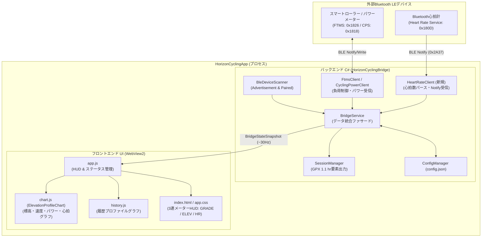
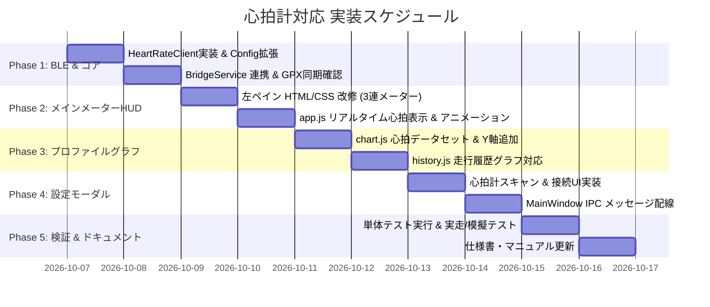

# HorizonCycling Studio - Bluetooth心拍計対応計画書

作成日: 2026-10-07  
対象バージョン: HorizonCycling Studio v1.1.0 (GUI) / HorizonCyclingBridge v0.6.0  
関連ドキュメント:
- [20260924-GUIプログラム構造仕様書.md](file:///d:/develop/HorizonCycling/docs/20260924-GUI%E3%83%97%E3%83%AD%E3%82%B0%E3%83%A9%E3%83%A0%E6%A7%8B%E9%80%A0%E4%BB%95%E6%A7%98%E6%9B%B8.md)
- [20260928-走行データの記録.md](file:///d:/develop/HorizonCycling/docs/20260928-%E8%B5%B0%E8%A1%8C%E3%83%87%E3%83%BC%E3%82%BF%E3%81%AE%E8%A8%98%E9%80%B2.md)
- [20260923-GUI化計画書.md](file:///d:/develop/HorizonCycling/docs/20260923-GUI%E5%8C%96%E8%A8%88%E7%94%BB%E6%9B%B8.md)

---

## 1. 計画の背景と目的

### 1.1 背景
HorizonCycling Studio は、Forza Horizon の車両シミュレーションとスマートサイクリングトレーナー（FTMS）やパワーメーター（CPS）を連動させ、実走さながらの負荷体験とリアルタイムデータHUDを提供しています。
しかし、サイクリストにとって **心拍数（Heart Rate, HR）** は、パワー（W）やケイデンス（RPM）と並ぶ最重要生理指標です。運動強度、疲労度、有酸素/無酸素運動ゾーンの管理、Strava / Garmin Connectでのトレーニング負荷（TSS・心拍ゾーン分析）の算出には、心拍計のデータが不可欠となります。

現在、`SessionManager` や GPX 出力部には心拍フィールド（`HeartRate` / `<gpxtpx:hr>`）の受け口がすでに存在していますが、Bluetooth LE 規格の心拍計（Heart Rate Service）を受信・管理するクライアント、およびGUI上での心拍数表示・グラフ描画機能が未実装のままとなっています。

### 1.2 目的
本計画では、以下の3つの主要目標を達成するためのアーキテクチャ設計、UI/UXデザイン、および実装ステップを定義します。

1. **Bluetooth LE 心拍計（Heart Rate Profile）への独立接続機能の実装**
   - スマートトレーナー/パワーメーターとは独立して、胸バンド式/アームバンド式/スマートウォッチ等のBLE心拍センサーと同時接続できるデュアルデバイス管理機構を構築。
2. **左ペイン・メインメーターのHUDレイアウト刷新**
   - 勾配（GRADE）と標高（ELEVATION）のサイズとグリッドを調整し、標高の右隣に「心拍計（HEART RATE）」を配置。視認性と統一感のある3連メーターを形成。
3. **走行プロファイルへの心拍数グラフの重畳表示**
   - 右ペインの「走行プロファイル」（Chart.js）および「走行履歴」において、標高・速度・パワーに加えて心拍数（bpm）のライングラフと専用Y軸を追加表示。

---

## 2. システム構成と全体アーキテクチャ

### 2.1 デュアルBLE接続アーキテクチャ
サイクリストの環境では、「スマートトレーナー（Tacx, Wahoo等）」と「心拍センサー（Polar, Garmin, Magene等）」が物理的に別個のデバイスとなるケースが大半です。そのため、従来の「1台のBLEデバイスに接続する」設計から、「パワーソース」と「心拍ソース」をそれぞれ独立してスキャン・接続・再接続できるアーキテクチャへ拡張します。



---

## 3. 詳細仕様設計

### 3.1 Bluetooth LE 心拍計通信仕様 (`HeartRateClient`)

Bluetooth SIG 標準の **Heart Rate Service (HRS)** および **Heart Rate Measurement Characteristic** に準拠します。

#### (1) GATT サービスおよびキャラクタリスティック定義
| 名称 | UUID | 種別 | 説明 |
| :--- | :--- | :--- | :--- |
| **Heart Rate Service** | `0000180d-0000-1000-8000-00805f9b34fb` | サービス | 標準心拍サービス |
| **Heart Rate Measurement** | `00002a37-0000-1000-8000-00805f9b34fb` | キャラクタリスティック | 心拍データ通知 (Notify 必須) |
| **Body Sensor Location** | `00002a38-0000-1000-8000-00805f9b34fb` | キャラクタリスティック | センサー装着部位 (Read, オプション) |
| **Client Characteristic Configuration (CCCD)** | `00002902-0000-1000-8000-00805f9b34fb` | ディスクリプタ | Notify有効化設定 |

#### (2) Heart Rate Measurement (0x2A37) パケット構造
受信バイト列の先頭（Flags）を判定し、心拍数（BPM）をデコードします。

```
+------------+-----------------------+---------------------+---------------------+
| Flags (1B) | Heart Rate Value (1~2B) | Energy Expended(2B) | RR-Interval (2B x N)|
+------------+-----------------------+---------------------+---------------------+
```

- **Flags (Byte 0)**:
  - `Bit 0`: Heart Rate Value Format (`0` = UINT8, `1` = UINT16)
  - `Bit 1-2`: Sensor Contact Status (`0b10` = 接触なし, `0b11` = 正常接触)
  - `Bit 3`: Energy Expended Status (`1` = 消費カロリーデータ含む)
  - `Bit 4`: RR-Interval Status (`1` = 心拍間隔データ含む)
- **Heart Rate Value**:
  - `Bit 0 == 0`: `Byte 1` をそのまま `byte` (0〜255 bpm) として読み取り。
  - `Bit 0 == 1`: `Byte 1` (下位) と `Byte 2` (上位) をリトルエンディアンで `ushort` として読み取り。

#### (3) 新規クラス: `HeartRateClient.cs`
- **名前空間**: `HorizonCyclingBridge.Trainer`
- **主要公開メンバー**:
  ```csharp
  public class HeartRateClient : IDisposable
  {
      public event Action<int>? OnHeartRateReceived;       // 心拍数(bpm)受信イベント
      public event Action<bool>? OnContactStatusChanged;     // 装着状態変化
      public event Action<string>? OnStatusMessage;          // ログメッセージ
      public event Action<bool>? OnConnectionStateChanged;   // 接続/切断イベント

      public bool IsConnected { get; }
      public string DeviceName { get; }
      public ulong BluetoothAddress { get; }

      public Task<bool> ScanAndConnectAsync(int timeoutMs = 20000, ulong targetAddress = 0);
      public void Disconnect();
      public void Dispose();
  }
  ```

---

### 3.2 設定データ（`config.json`）の拡張

パワーソースと心拍センサーの設定を独立して永続化できるようにスキーマを拡張します。

```json
{
  "PowerSourceType": 1,
  "PowerSourceMacAddress": 252096489896296,
  "PowerSourceName": "T2 13991",

  "HeartRateSourceMacAddress": 234857201948123,
  "HeartRateSourceName": "Polar H10 8B72",
  "HeartRateEnabled": true,

  "DefaultMode": 2,
  "TrainerDifficulty": 0.65,
  "Ftp": 200.0,
  "MaxHeartRate": 190,
  "PedalBrakeEnabled": false,
  "MapOriginX": -612.189,
  "MapOriginZ": -223.001,
  "MapScale": 0.263,
  "InvertZ": true
}
```

| 設定キー | 型 | 初期値 | 説明 |
| :--- | :---: | :---: | :--- |
| `HeartRateSourceMacAddress` | ulong | `0` | 接続対象心拍計のBluetooth MACアドレス（0なら未登録） |
| `HeartRateSourceName` | string | `""` | 接続対象心拍計の表示デバイス名 |
| `HeartRateEnabled` | bool | `true` | 心拍計自動接続機能の有効/無効 |
| `MaxHeartRate` | int | `190` | ライダーの最大心拍数（心拍ゾーンZ1〜Z5の算出基準） |

---

### 3.3 左ペイン HUD メインメーターの再設計

ユーザー指示:
> 「左ペインのメインメーターに心拍を表示できるようにする。ELEVATIONの右側に表示。GRADEとELEVATIONのサイズを調整。」

#### (1) ワイヤーフレーム構成比較

**現在 (現行レイアウト)**:
```
+-------------------------------------------------------------+
| POWER: 215 W   |  3.1 W/kg (Zone Bar)                       |
+------------------------------+------------------------------+
| CAR SPEED: 32.4 km/h         | TARGET SPEED: 31.8 km/h      |
+------------------------------+------------------------------+
| GRADE (勾配)                 | ELEVATION (標高)             |  <-- metric-row-dual (2列)
|   [ +4.5 ] %                 |   [  342  ] m                |
|   送信: 3.2%                 |   獲得標高: +185 m           |
+------------------------------+------------------------------+
| CADENCE: 88 rpm | GEAR: 4    | DISTANCE: 12.40 km           |  <-- metric-row-triple (3列)
+-------------------------------------------------------------+
| THROTTLE / BRAKE                                            |
+-------------------------------------------------------------+
```

**改修後 (新レイアウト: 3連メーター化)**:
```
+-------------------------------------------------------------+
| POWER: 215 W   |  3.1 W/kg (Zone Bar)                       |
+------------------------------+------------------------------+
| CAR SPEED: 32.4 km/h         | TARGET SPEED: 31.8 km/h      |
+-------------------+--------------------+--------------------+
| GRADE             | ELEVATION          | HEART RATE         |  <-- metric-row-triple (3列均等)
|   [ +4.5 ] %      |   [  342  ] m      |   [  142  ] bpm    |
|   送信: 3.2%      |   獲得: +185m      |   Z3 (75% HRmax)   |
+-------------------+--------------------+--------------------+
| CADENCE: 88 rpm   | GEAR: 4            | DISTANCE: 12.40 km |
+-------------------------------------------------------------+
| THROTTLE / BRAKE                                            |
+-------------------------------------------------------------+
```

#### (2) サイズ・スタイル調整のポイント
- **グリッド構造**: `metric-row-dual` から `metric-row-triple` へ変更（または専用クラス `.metric-row-middle`）。
- **フォントサイズ調整**:
  - `large-number` (従来 32px〜36px) のままだと横幅が圧迫されるため、3列配置に合わせて数値を `26px〜28px` に微調整。
  - 単位フォント（`%`, `m`, `bpm`）を `12px〜13px` にスケーリング。
- **サブラベルの文字数最適化**:
  - GRADE: `送信: +0.0%`
  - ELEVATION: `獲得: +0m` (文字数を短縮して改行やはみ出しを防止)
  - HEART RATE: `Z3 (75%)` または `❤️ 正常` (心拍ゾーンと最大心拍比率を表示)
- **アクセントカラー & ビジュアル**:
  - 心拍カードは脈動感のある **パルスローズ/レッド** (`--accent-heart: #f43f5e`) を採用。
  - 心拍受信中はハートアイコン（`❤️`）に微小なスケールパルスアニメーション（CSS keyframes: `heartbeat`）を付与。

---

### 3.4 走行プロファイル（Chart.js）への心拍グラフ統合

ユーザー指示:
> 「心拍はプロファイルにグラフとしても表示する。」

#### (1) `chart.js` (`ElevationProfileChart`) の拡張
- **新規データセットの追加**:
  - ラベル: `心拍数 (bpm)`
  - データセット色: `#f43f5e` (ローズレッド)
  - 線幅: `1.8px`、点非表示（ホバー時のみ半径4px）
  - スタイル: ソリッドライン、スムーズテンション `0.2`
- **マルチY軸構成**:
  - `yElevation` (左軸): 標高 (m) (グリーン `#10b981`)
  - `ySpeed` (右軸1): 速度 / 目標速度 (km/h) (シアン `#06b6d4` / パープル `#a855f7`)
  - `yPower` (右軸2): パワー (W) (アンバー `#f59e0b`)
  - `yHeartRate` (右軸3 または スケール共有): 心拍数 (bpm) (ローズ `#f43f5e`, 範囲 40〜200 bpm)
  - ※ 軸が乱立してプロファイル領域が狭くならないよう、Chart.js の軸目盛りはすっきりと整理し、ツールチップで詳細値を一覧表示。
- **サンプリングデータ拡張**:
  - 距離3mごとのサンプリング配列に `hr` を追加:
    `{ distKm, distM, ele, speed, targetSpeed, power, hr }`
- **プロファイル上部HUDバーの拡張**:
  - 現在標高、速度/目標、パワー、獲得標高、総走行距離に加え、**「心拍数（現在 / 平均 / 最大）」** の表示カードを追加。

#### (2) `history.js`（走行履歴プロファイル）の拡張
- 保存されたGPXログの `<gpxtpx:hr>` 値をパースし、過去ログ閲覧画面のチャートにも心拍数ラインを描画。
- 履歴サマリーに「平均心拍数」「最大心拍数」を表示。

---

### 3.5 設定モーダル（UI）の拡張

設定画面（`settingsModal`）において、トレーナーと心拍計の接続を明確に分掌します。

```
+---------------------------------------------------------------+
| ⚙ システム & センサー設定                                      [✕]|
+---------------------------------------------------------------+
|  🚴 スマートローラー / パワーメーター                         |
|    現在設定中: T2 13991 (252096489896296)  [🟢 接続中]        |
|    [🔍 トレーナーを検索]   [切断]                             |
+---------------------------------------------------------------+
|  ❤️ Bluetooth 心拍計 (Heart Rate Monitor)                      |
|    現在設定中: Polar H10 8B72 (234857201948123)  [🟢 接続中]  |
|    [🔍 心拍計を検索]   [切断]                                 |
|    [デバイススキャン一覧 (心拍計のみフィルタ)]                 |
|    [選択した心拍計に接続]                                     |
+---------------------------------------------------------------+
|  ⚙ サイクリング設定                                            |
|    ライダー FTP (W): [ 200 ]                                  |
|    最大心拍数 (bpm): [ 190 ]                                  |
|    ペダル自動ブレーキ: [ ON / OFF ]                           |
+---------------------------------------------------------------+
```

- スキャン結果リストに種別アイコンバッジ（`🚴 FTMS/Power` / `❤️ Heart Rate`）を表示し、誤接続を防止。
- フッターのステータスインジケーターにも心拍計の接続状態アイコンを追加。

---

## 4. 影響範囲・変更ファイル一覧

| 区分 | 対象ファイル | 主な改修内容 |
| :--- | :--- | :--- |
| **新規** | `src/HorizonCyclingBridge/Trainer/HeartRateClient.cs` | Bluetooth LE Heart Rate Service (0x180D) 通信クライアント新規実装 |
| **コア** | `src/HorizonCyclingBridge/Core/Config.cs` | `AppConfig` に心拍計設定（MacAddress, Name, Enabled, MaxHeartRate）追加 |
| **コア** | `src/HorizonCyclingBridge/Core/BridgeService.cs` | 心拍計ライフサイクル管理、スキャン機能での0x180D収集、`_currentHeartRate` の実機更新 |
| **GUI** | `src/HorizonCyclingApp/MainWindow.xaml.cs` | 心拍計用 IPC（`connectHeartRate`, `disconnectHeartRate`）追加、初期設定連携 |
| **UI** | `src/HorizonCyclingApp/wwwroot/index.html` | 左ペインのGRADE/ELEVATION/HR 3連化、プロファイルHUDに心拍追加、設定モーダルに心拍セクション追加 |
| **UI** | `src/HorizonCyclingApp/wwwroot/css/app.css` | 3連メーター用CSSグリッド、心拍パルスカラー、ハートビートアニメーション、プロファイルHUDスタイル |
| **UI** | `src/HorizonCyclingApp/wwwroot/js/app.js` | 心拍スナップショット反映、心拍ゾーン計算、心拍計スキャン・接続イベントハンドリング |
| **UI** | `src/HorizonCyclingApp/wwwroot/js/chart.js` | プロファイルチャートへの心拍データセット追加、右Y軸（HR）設定、ツールチップ更新 |
| **UI** | `src/HorizonCyclingApp/wwwroot/js/history.js` | 履歴チャートでの心拍表示、GPXパース時の心拍データ抽出 |
| **テスト** | `tests/HorizonCycling.Tests/` | 心拍パケットデコードおよび設定保存の単体テスト追加 |

---

## 5. 実装ステップと作業計画

本計画は以下の5つのフェーズに分割して安全・確実に実施します。



### Phase 1: BLE 心拍クライアント & コアライブラリ改修
1. `HeartRateClient.cs` の作成（Windows.Devices.Bluetooth を使用した HRS 接続・Notify 受信・デコード）。
2. `Config.cs` に心拍計設定プロパティを追加し、`config.json` への読み書きをサポート。
3. `BridgeService.cs` に `HeartRateClient` を組み込み、スキャン対象に `0x180D` を追加。心拍パケット受信時に `_currentHeartRate` を更新。
4. `SessionManager` との連動確認（走行ログ GPX への `<gpxtpx:hr>` 出力担保）。

### Phase 2: 左ペイン メインメーターの HUD 刷新
1. `index.html`: GRADE と ELEVATION のコンテナを 3連構成に変更し、ELEVATION の右側に HEART RATE カードを新設。
2. `app.css`: GRADE, ELEVATION, HEART RATE の幅・マージン・フォントサイズ（数値 28px、ラベル、単位）を最適化。心拍用のネオンローズカラーとハートアイコンアニメーションを追加。
3. `app.js`: スナップショットの `s.HeartRate` を受け取り、BPM値および心拍ゾーン（Z1〜Z5 / %HRmax）をリアルタイム更新。

### Phase 3: 走行プロファイル（Chart.js）への心拍グラフ統合
1. `chart.js`: `ElevationProfileChart` のデータセットに「心拍数 (bpm)」を追加。
2. Y軸定義に `yHeartRate`（または適切な複合スケール）を設定。
3. プロファイル上部のHUDサマリーに心拍数表示（現在/平均/最大）を追加。
4. `history.js`: 過去のセッション履歴を開いた際も心拍グラフが表示されるよう改修。

### Phase 4: 設定画面（モーダル）とスキャン・接続機能の拡張
1. `index.html`: 設定モーダル内に「Bluetooth 心拍計」の専用設定セクションを追加。
2. `MainWindow.xaml.cs`: `connectHeartRate`、`disconnectHeartRate` などの IPC ハンドラを実装。
3. `app.js`: トレーナーと心拍計それぞれのスキャン・接続状態をUI上に独立して表現。

### Phase 5: テスト・総合動作確認
1. `dotnet test`: 既存の単体テストがすべてパスすることを確認。
2. 擬似パケットまたは実機BLE心拍計を用いた接続・受信テスト。
3. セッション記録開始〜保存を行い、生成された GPX に正しい `<gpxtpx:hr>` が書き出されていることを検証。
4. 仕様書・README の更新。

---

## 6. リスクと対策

| リスク要因 | 影響度 | 対策 |
| :--- | :---: | :--- |
| **BLEアダプタのマルチデバイス同時接続上限** | 中 | 多くのWindows PC標準Bluetooth 4.0/5.0チップは4〜7台の同時BLE接続をサポートしているため通常は問題ないが、片方がタイムアウトした際にもう片方の接続に影響を与えないよう、Taskを完全分離して並列実行する。 |
| **HUD 3連化によるフォントの視認性低下** | 低 | 画面幅が狭い場合でも数値が折り返さないよう、`Roboto Mono` のフォントサイズを 26〜28px に設定し、単位とサブラベルをコンパクトにまとめる。 |
| **Chart.js の軸過多によるグラフ可読性低下** | 中 | 標高（面グラフ）をメインとし、心拍数（線グラフ）と速度・パワーの線色・破線を明確に差別化する。ツールチップでポイントごとの全値を明瞭に表示する。 |
| **心拍計未装着（Contact Status False）時の値** | 低 | 装着していない場合や胸バンドが外れた場合は `0 bpm` または `--` 表示とし、グラフでは直前の有効値を保持するか欠損値として扱う。 |

---

## 7. まとめ

本計画を実施することにより、HorizonCycling Studio は「ペダリングパワーによる走行連動」に加えて「ライダーの心拍生体データによる本格的なトレーニング＆コンディション管理」をシームレスに実現します。
画面構成も Zwift や Wahoo 等の本格的サイクリングアプリと同等以上の洗練されたレイアウトへ進化します。
計画承認後、Phase 1 より順次実装に着手します。
