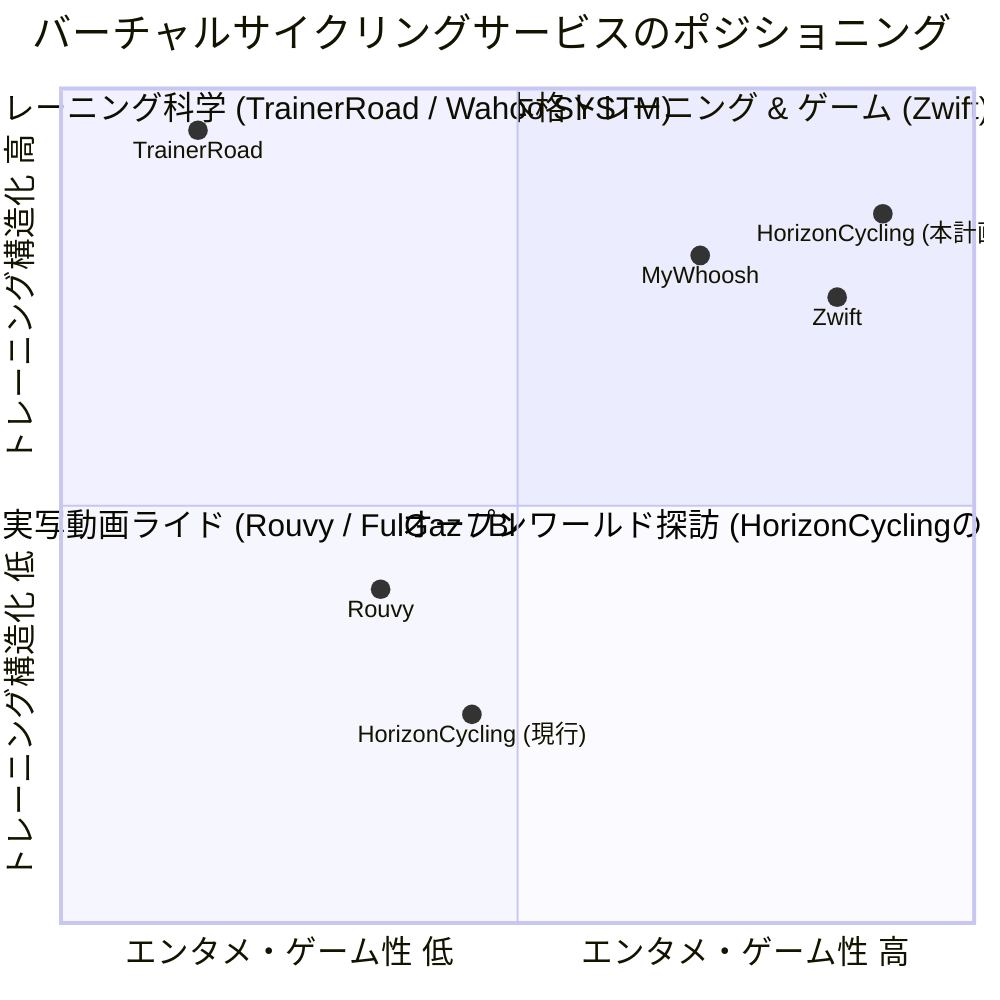
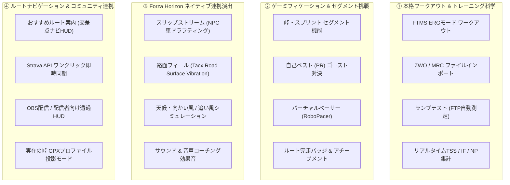
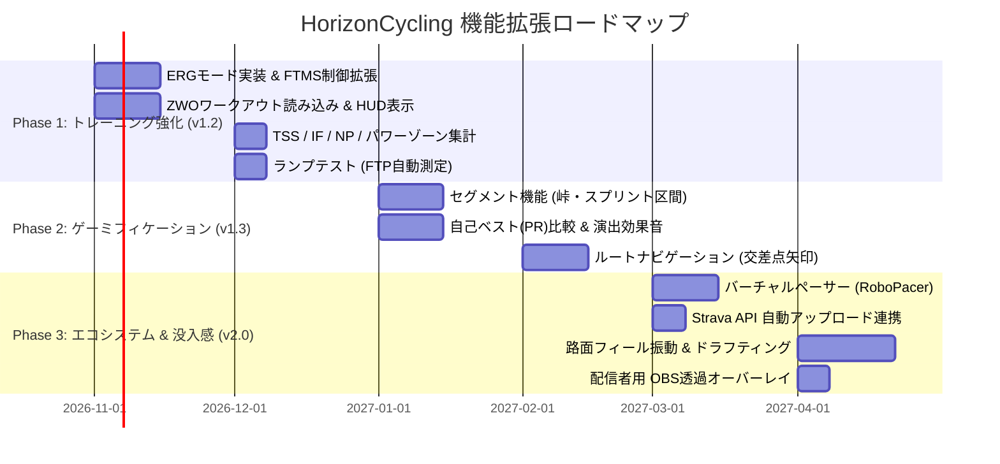

# HorizonCycling Studio - 「もっと楽しく・もっと鍛えられる」機能拡張検討書

作成日: 2026-10-10  
対象バージョン: HorizonCycling Studio v1.2.0〜v2.0.0 構想  
ドキュメント種別: 新機能検討・企画・アーキテクチャ提案書  
関連ドキュメント:
- [20261010-ワークアウト機能と最前面HUDオーバーレイ検討.md](file:///d:/develop/HorizonCycling/docs/20261010-%E3%83%AF%E3%83%BC%E3%82%AF%E3%82%A2%E3%82%A6%E3%83%88%E6%A9%9F%E8%83%BD%E3%81%A8%E6%9C%80%E5%89%8D%E9%9D%A2HUD%E3%82%AA%E3%83%BC%E3%83%90%E3%83%BC%E3%83%AC%E3%82%A4%E6%A4%9C%E8%A8%8E.md)
- [20260923-GUI化計画書.md](file:///d:/develop/HorizonCycling/docs/20260923-GUI%E5%8C%96%E8%A8%88%E7%94%BB%E6%9B%B8.md)
- [20260924-GUIプログラム構造仕様書.md](file:///d:/develop/HorizonCycling/docs/20260924-GUI%E3%83%97%E3%83%AD%E3%82%B0%E3%83%A9%E3%83%A0%E6%A7%8B%E9%80%A0%E4%BB%95%E6%A7%98%E6%9B%B8.md)
- [20260928-走行データの記録.md](file:///d:/develop/HorizonCycling/docs/20260928-%E8%B5%B0%E8%A1%8C%E3%83%87%E3%83%BC%E3%82%BF%E3%81%AE%E8%A8%98%E9%80%B2.md)
- [20261007-心拍計対応.md](file:///d:/develop/HorizonCycling/docs/20261007-%E5%BF%83%E6%8B%8D%E8%A8%88%E5%AF%BE%E5%BF%9C.md)

---

## 1. はじめに：HorizonCyclingの独自価値と課題

### 1.1 HorizonCycling Studioのユニークな強み (USP)
HorizonCycling Studio は、市販のバーチャルサイクリングアプリ（Zwift、Rouvy、TrainerRoad、MyWhoosh等）と比較して、極めて特異かつ強力なアドバンテージを持っています。

1. **圧倒的な映像美とオープンワールド空間**:
   - レーシングシミュレーター最高峰のグラフィックエンジン（Forza Horizon 5/6）による天候変化、四季の移ろい、夕暮れ・夜間のライティング、日本の名所・大自然。
   - レールの上を走るだけの動画アプリ（RouvyやFulGaz）や、グラフィックが簡素化されたZwiftにはない、**「どこへでも自由に曲がり、自由に探索できる完全なオープンワールド」**。
2. **リアルな車両挙動と物理シミュレーション**:
   - 車両のサスペンション、路面摩擦、空気抵抗、スリップストリーム、勾配に応じた本物の物理演算。
   - スマートトレーナー（FTMS）の自動負荷変動と、vJoy経由の入力連動。

### 1.2 現状の課題（何が足りないのか？）
現在の HorizonCycling Studio は「実車の走行連動」「地図追跡」「標高表示」「ログ記録」という**インフラ基盤**が完成した状態です。
しかし、サイクリストが日々のルーティンとして継続し、楽しむためには以下の要素が不足しています。

| 不足している要素 | 現状の課題 | 求められる体験 |
| :--- | :--- | :--- |
| **目的・ゴールの不在** | オープンワールド故に「どこをどう走ればいいか」迷う | おすすめルート、セグメント（峠・スプリント区間）への挑戦 |
| **トレーニング科学の不足** | フリーライドのみで、計画的な体力強化が難しい | 目標ワット固定の構造化ワークアウト（ERGモード）、FTPテスト |
| **ゲーム性と達成感の不足** | 走ってもアプリ内での報酬や記録更新の実感に乏しい | 自己ベスト（PR）比較、バーチャルペーサー、バッジ・XP |
| **Forzaとの一体感** | ゲーム側の世界とサイクリングHUDが完全に融合しきれていない | ドラフティング（スリップストリーム）、路面振動フィール、OBS配信HUD |

---

## 2. 先行バーチャルサイクリングアプリの分析と差別化

主要なインドアサイクリングサービスの強みを抽出し、HorizonCycling にどのように取り込むべきかを整理します。



### 2.1 ベンチマーク分析

1. **Zwift（業界標準・ゲーミフィケーションの王者）**:
   - **優れている点**: ルート完走バッジ、スプリント/山岳セグメント（Strava Live Segments様式）、バーチャルペーサー（RoboPacer）、ドラフティング効果、ワークアウトの視覚的UI（アーチをくぐる演出）。
   - **HorizonCyclingへの適用**: セグメントタイムアタック、仮想ペーサー、ワークアウトHUD。
2. **TrainerRoad / Wahoo SYSTM（サイクリング科学の頂点）**:
   - **優れている点**: ERGモード（スマートトレーナーの負荷を強制固定し、目標ワットを維持させる）、Coggan 7ゾーン管理、TSS（トレーニングストレススコア）、NP（標準化パワー）。
   - **HorizonCyclingへの適用**: FTMS ERGモード制御、ZWOファイル再生、ゾーン滞在時間グラフ。
3. **Rouvy / FulGaz（リアル感・実走体験）**:
   - **優れている点**: 実在の有名な峠（ラルプ・デュエズ、富士あざみライン等）の再現。
   - **HorizonCyclingへの適用**: 実在GPXの標高プロファイル投影、日本マップの名所巡りルート。

---

## 3. 「もっと楽しく・鍛えられる」新機能 4大ピラー（柱）

本計画では、機能を以下の **4つの柱（Pillars）** に分類して提案します。



---

## 4. 各機能の詳細仕様とUI/UX設計

### 4.1 Pillar 1: 本格ワークアウト & トレーニング科学

#### (1) スマートトレーナー ERGモード制御 (`Target Power Mode`)
- **概要**:
  - 現在のHorizonCyclingは、ゲーム内の勾配（%）をトレーナーに送る「シミュレーションモード（SIMモード）」のみです。
  - **ERGモード** では、スマートトレーナー（FTMS）の `Set Target Power (0x1826)` コマンドを使用し、斜度に関係なく「指定したワット数」でペダル負荷を自動固定します（ケイデンスを上げれば軽くなり、落とせば重くなる）。
  - Forza Horizon側では、ライダーが出している実際のパワーに応じてアクセルを踏み込むため、**「美しいオープンワールドをドライブしながら、極めて厳密なインターバルトレーニング」** が可能になります。
- **ワークアウトHUD（画面イメージ）**:
  ```text
  +------------------------------------------------------------------------------------+
  | 🏋️ WORKOUT: 2x15min FTP SweetSpot [ 24:15 / 45:00 ]  [TARGET: 210W (88% FTP)]      |
  | [==== WARMUP ====] [====== INTERVAL 1 (210W) ======] [=== REST ===] [== INTERVAL 2 =]
  | 現在ブロック: あと 02:45 | 目標: 210 W (実測: 212 W 🟢) | 目標ケイデンス: 90 rpm (実測: 88) |
  +------------------------------------------------------------------------------------+
  ```

#### (2) ZWO / MRC 形式ワークアウトのインポート
- 世界標準である Zwift 形式のワークアウトファイル（`.zwo` / XML形式）や TrainerRoad 形式（`.mrc` / `.erg`）をドラッグ＆ドロップで読み込み可能にします。
- インターネット上に数万種類存在する有名ワークアウト（Gorby、The Wringer、SST Short等）がそのままHorizonCyclingで実行できます。

#### (3) ランプテスト（FTP自動計測モード）
- **仕様**:
  - ウォームアップ（100W）からスタートし、1分ごとに `+20W` ずつ目標負荷が自動で段階上昇。
  - ペダルを回せなくなってケイデンスが一定値（例: 50rpm）を3秒以上下回った時点で自動終了。
  - 最後の1分間の最大平均パワーの75%を新しい **FTP（機能的作業閾値）** として自動算出し、`config.json` をワンクリック更新。

#### (4) リアルタイム・パワートレーニング指標のHUD表示
- **算出項目**:
  - **NP (Normalized Power)**: 30秒移動平均を用いた生理学的変動負荷パワー。
  - **IF (Intensity Factor)**: `NP / FTP`（運動強度の割合）。
  - **TSS (Training Stress Score)**: その日の疲労度・トレーニング負荷の定量化。
  - **Coggan 7ゾーン滞在時間**:
    - Z1 (回復: <55% FTP)
    - Z2 (有酸素: 56-75%)
    - Z3 (テンポ: 76-90%)
    - Z4 (閾値: 91-105%)
    - Z5 (VO2Max: 106-120%)
    - Z6 (無酸素: 121-150%)
    - Z7 (神経筋: 150%超)
    - 画面右ペインまたはサマリーにカラフルな帯グラフでリアルタイム集計。

---

### 4.2 Pillar 2: ゲーミフィケーション & セグメント挑戦

#### (1) セグメント（峠・スプリント区間）自動判定 & タイムアタック
- **概要**:
  - Forzaの日本マップ上に「セグメント（計測区間）」を定義（例: 富士山ヒルクライム、湾岸スプリント1km、旧峠アタック等）。
  - 車両がセグメントのスタート地点（半径20m以内）を通過すると、画面に派手な演出とともに **「🏁 SEGMENT START!」** と表示され、タイムアタックモードに突入。
- **セグメント走行中のHUDオーバーレイ**:
  ```text
  +-------------------------------------------------------------+
  | 🏁 富士見パノラマ・ヒルクライム [残り 1.42 km / 勾配 +6.8%]   |
  | ⏱ タイム: 04:12.8  | 自己ベスト(PR): 05:40.0                |
  | ⚡ PR比較: -00:15.2 (15秒先行中! 🟢)                         |
  | 📊 区間平均パワー: 245 W | 推定フィニッシュ: 05:24.8 (新記録ペース)|
  +-------------------------------------------------------------+
  ```
- **フィニッシュ時の演出**:
  - ゴールライン通過時に「🎉 NEW PR! (自己ベスト更新)」や「🥈 歴代2位」のトロフィーバッジが表示され、効果音が鳴る。

#### (2) バーチャルペーサー（RoboPacer / Pace Partner）
- **概要**:
  - 初心者から上級者まで、自分に合ったペースで走り続けるための仮想パートナー機能。
  - 地図上に一定のワット数（W/kg）で走行する仮想ペーサー（アイコン）を召喚。
- **ペーサーカテゴリ例**:
  - 🟢 **D. Tanuki (1.5 W/kg)**: まったりポタリング・回復走ペース
  - 🔵 **C. Kitsune (2.5 W/kg)**: 有酸素ベーストレーニング（Z2）
  - 🟡 **B. Tora (3.3 W/kg)**: テンポ〜閾値ペース（しっかり追い込み）
  - 🔴 **A. Ryu (4.2 W/kg)**: レースペース・超ハイペース
- ペーサーの周囲（前後20m圏内）に留まると「ペーサーボーナスXP（経験値）」が2倍獲得できるなど、一定強度での持続走を楽しく動機づけます。

#### (3) ルートバッジ & 実績アチーブメントシステム
- 「初ライド完了（5km）」「富士山登頂（獲得標高1,000m突破）」「スプリンター（最大瞬間パワー700W超）」「エベレスティング（累計獲得標高8,848m）」「センチュリーライド（1回で100km走破）」などの実績アンロック機能を搭載。

---

### 4.3 Pillar 3: Forza Horizon ネイティブ連携演出

#### (1) ドラフティング（スリップストリーム）シミュレーション
- **Forzaのテレメトリを活用した革新機能**:
  - Forzaでは、前方を走るNPC一般車やライバル車（Drivatar）のワールド座標・速度が取得可能（または車間距離と車速低下から算出）。
  - 前走車の真後ろ（1m〜8m以内）に入った場合、空気抵抗係数を **20%〜35% 自動低減**。
  - 同じ200Wで漕いでいても、スリップストリームに入ると時速が `32km/h ➔ 38km/h` に急加速！
  - HUDに「💨 DRAFTING (空気抵抗 -30%)」と表示。一般車の後ろについて高速巡航する、オープンワールドならではの興奮を演出。

#### (2) 路面フィール振動（Road Surface Vibration）
- **Tacx NEO等の対応トレーナー向け機能**:
  - Forzaのテレメトリ `SurfaceRumble` やサスペンション振動、路面摩擦係数（アスファルト/ダート/砂利/芝生/木橋）を監視。
  - FTMS Road Surface Simulation コマンドを発行し、**「アスファルトから未舗装路に入った瞬間にペダルがガタガタとリアルに振動する」** 超没入体験を実現。

#### (3) サウンドエフェクト & 音声ガイド
- セグメント開始時、目標パワー未達時（「もっと踏んで！」「ケイデンス上げて！」）、自己ベスト更新時などに心地よいゲームサウンドや日本語音声ガイドを再生。

---

### 4.4 Pillar 4: ルートナビゲーション & コミュニティ連携

#### (1) プリセットルート案内と交差点ナビゲーション
- **課題**: オープンワールドでは、意図したコースを走るために頻繁に地図を確認しなければならず、ペダリングに集中できない。
- **解決策**:
  - アプリ内で「おすすめルート（例: 富士山周回 30km、湾岸ハイウェイ 15km）」を選択。
  - 地図上に青いルートラインが引かれ、交差点の150m手前で画面上部に **「⬅ 100m先 左折」「⬆ 直進」** の矢印ナビHUDを表示。
  - ルート通りに走るだけで、迷うことなく風光明媚なサイクリングを満喫できる。

#### (2) Strava API ワンクリック自動同期
- 現在のGPXファイル保存に加え、StravaのOAuth2 APIと連携。
- 走行終了時に「Stravaにアップロード」ボタンを押すだけで、タイトル（例: `HorizonCycling - 富士山周回 28.4km`）と写真・スタッツ付きで即座にクラウドへ送信。

#### (3) 配信者向け OBS 透過オーバーレイHUD
- YouTubeやTwitchでのインドアサイクリング配信者向けに、ブラウザソースとして読み込める透過背景の専用HUDページ（`https://horizoncycling.local/overlay.html`）を提供。
- Forzaのゲーム画面の上に、アニメーションするパワーメーター、心拍数、ミニマップを美しく重ねて配信可能。

---

## 5. UIワイヤーフレーム案：新ダッシュボード

### 5.1 ワークアウト / セグメント実行時の統合HUD
画面左ペインと右ペインに、トレーニングモードに応じた動的ウィジェットを追加します。

```text
+---------------------------------------------------------------------------------------------------------+
| [● REC 00:32:15]  HorizonCycling Studio   [MODE: ERG WORKOUT ▼]   [ROBOPACER: B.Tora (3.3W/kg) 🐱] [⚙]  |
+------------------------------------+--------------------------------------------------------------------+
| 【左ペイン: メインメーターHUD】   | 【右ペイン: ワークアウト & セグメント 統合ビュー】                 |
|                                    |  [ 🗺 リアルタイム追跡 ]  [ 🏋️ ワークアウト ]  [ 🏁 セグメント ]   |
|   POWER              TARGET POWER  | +----------------------------------------------------------------+ |
|    [  242  ] W       [  240  ] W   | | 🏋️ ワークアウト: SST (Sweet Spot Training) 45min               | |
|   3.4 W/kg (Z4 閾値)   誤差: +2W   | | [ WARMUP (120W) ] [==== SST 240W (残り 03:20) ====] [ REST... ]| |
|  --------------------------------  | | 目標ケイデンス: 90 rpm (現在: 92) | 現在ブロック完了まで: 03:20    | |
|   CAR SPEED          TARGET SPEED  | +----------------------------------------------------------------+ |
|    [ 36.2 ] km/h     [ 35.8 ] km/h | 【直近標高 & ゾーン推移プロファイル】                              |
|  --------------------------------  |  300m|                      /''''''''\  (Z4 ゾーン維持区間)       |
|   GRADE    ELEVATION   HEART RATE  |  200m|            /'''''''''          \                           |
|   [+3.5]%   [ 412 ]m   [ 158 ]bpm  |  100m+-----------/----------------------\----------現在地●-------+ |
|   送信:3.5% 獲得:+380m  Z4 (83%)   |      -2.0km                     -1.0km                0km (現在)   |
|  --------------------------------  | +----------------------------------------------------------------+ |
|   CADENCE    GEAR      DISTANCE    | | 📊 本日のスタッツ: TSS: 42.5 | IF: 0.88 | NP: 232W | 485 kcal   | |
|   [ 92 ]rpm  [ 5 ]     [ 16.80 ]km | | 🏆 直前セグメント: 富士見坂 (PR更新! -12.4秒 🥇)              | |
|  --------------------------------  | +----------------------------------------------------------------+ |
|   THROTTLE: [||||||||||||  ] 75%   |                                                                    |
|   DRAFT   : [||||||||||    ] -25%  | (💨 NPCトラックの真後ろをドラフティング中: 抵抗 -25% 発動中!)     |
+------------------------------------+--------------------------------------------------------------------+
| STATUS: [BLE: FTMS 🟢] [HRM: Connected ❤️] [Forza UDP: 60Hz 🟢] [vJoy: 🟢]       [💾 走行終了 & 保存]    |
+---------------------------------------------------------------------------------------------------------+
```

---

## 6. 実装実現性（Feasibility）と技術検証

各機能の技術的実現可能性を、既存のアーキテクチャ（C# / Forza UDP / BLE / Leaflet.js）に基づいて評価します。

| 機能項目 | 実現難易度 | 技術的要件・依存関係 | 実現可能性 |
| :--- | :---: | :--- | :---: |
| **FTMS ERGモード制御** | **中** | FTMSの `Set Target Power` キャラクタリスティックへの書き込み。既存の `FtmsClient.cs` の拡張で実装可能。 | **◎ 高い** |
| **ZWO形式インポート** | **低** | 標準的なXMLファイルパーサー。C#の `XDocument` またはJSの `DOMParser` で即座にパース可能。 | **◎ 極めて高い** |
| **セグメントタイムアタック** | **中** | `CoordinateEngine` での通過判定（円またはポリゴン判定）とタイム計測。セグメント定義JSONを作成。 | **◎ 高い** |
| **ドラフティング効果** | **中〜高** | Forza UDPテレメトリの他車座標、または前方障害物/サスペンションテレメトリの解析。単車の場合は速度閾値連動の仮想ドラフトも可能。 | **◯ 実現可能** |
| **路面フィール振動** | **中** | FTMS規格の `Indoor Bike Simulation (0x2AD9)` 内の表面パラメータ。Tacx NEO等の実機テストが必要。 | **◯ 実現可能** |
| **ルートナビゲーション** | **中** | 名所ピン（`pins.json`）の拡張としてルートWaypointを定義。自車位置と次Waypointの距離・方位角から案内生成。 | **◎ 高い** |
| **Strava API 同期** | **中** | Strava OAuth2 認証と GPX アップロードエンドポイントへの POST 送信。 | **◎ 高い** |

---

## 7. 段階的開発ロードマップ（フェーズ分け案）

新機能を一度に実装するのではなく、価値が高く実現しやすいものから段階的にリリースする計画です。



### Phase 1: 「本格トレーニングアプリ化」（v1.2）
- **ゴール**: 雨の日でも自宅で計画的なFTP向上トレーニングができる環境を整える。
- **実装内容**:
  1. スマートトレーナーの ERGモード制御
  2. ZWO / MRC ワークアウト再生エンジン & ワークアウトHUD
  3. Coggan 7ゾーンおよび TSS / IF / NP のリアルタイム集計
  4. FTP計測ランプテスト

### Phase 2: 「走る目的とゲーム性の獲得」（v1.3）
- **ゴール**: オープンワールドをただ走るだけでなく、目標とライバル（過去の自分）と競い合える。
- **実装内容**:
  1. マップ上のセグメント（峠・スプリント区間）定義と自動タイムアタック判定
  2. 自己ベスト（PR）比較HUDとゴースト機能
  3. おすすめサイクリングルートと交差点ナビゲーション（矢印ガイド）
  4. サウンドエフェクト（セグメント通過音、カウントダウン等）

### Phase 3: 「究極の没入感とコミュニティ連携」（v2.0）
- **ゴール**: 世界唯一の「Forza Horizon バーチャルサイクリング」としての完成度を高める。
- **実装内容**:
  1. バーチャルペーサー（RoboPacer）機能
  2. Strava API へのワンクリック即時アップロード
  3. NPC車ドラフティングシミュレーション & Tacx 路面フィール振動
  4. OBS配信用透過HUDオーバーレイ

---

## 8. まとめ

HorizonCycling Studio が従来の Zwift や Rouvy の単なる「模倣」にとどまらず、**「オープンワールドの自由度と圧倒的なグラフィック × 本格的なパワートレーニング科学」** を融合させることで、世界で唯一無二のバーチャルサイクリング体験が誕生します。

まずは最も実用性が高く、日々のフィットネス効果に直結する **「Phase 1: ERGモード・ワークアウト機能（ZWO対応）」** および **「Phase 2: セグメント（タイムアタック）機能」** から着手することを推奨します。
