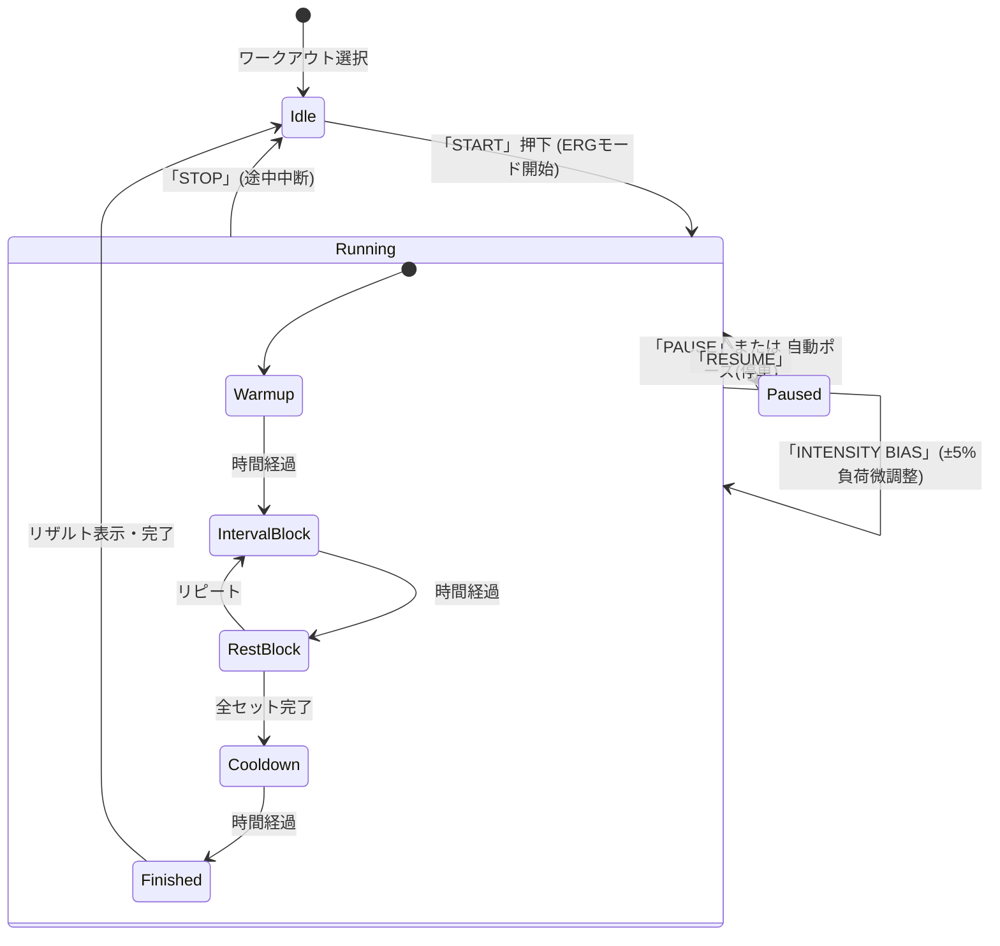
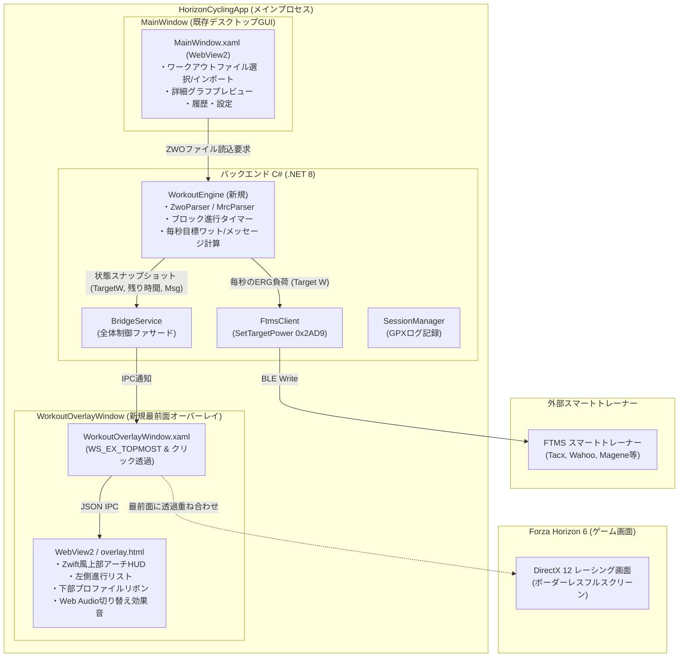
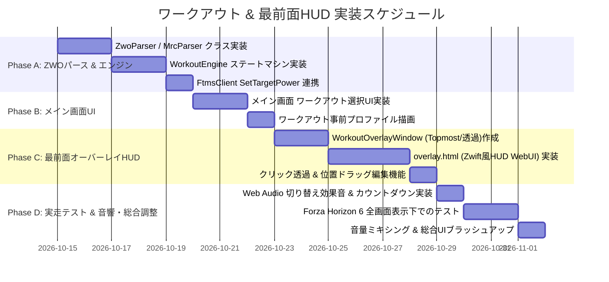

# HorizonCycling Studio - ワークアウト機能 & 最前面HUDオーバーレイ仕様検討書

作成日: 2026-10-10  
対象バージョン: HorizonCycling Studio v1.2.0  
ドキュメント種別: ワークアウト機能・ZWO/MRCインポート・最前面In-Game Overlay技術仕様書  
関連ドキュメント:
- [20261010-もっと楽しく自転車トレーニング.md](file:///d:/develop/HorizonCycling/docs/20261010-%E3%82%82%E3%81%A3%E3%81%A8%E6%A5%BD%E3%81%97%E3%81%8F%E8%87%AA%E8%BB%A2%E8%BB%8A%E3%83%88%E3%83%AC%E3%83%BC%E3%83%8B%E3%83%B3%E3%82%B0.md)
- [20260924-GUIプログラム構造仕様書.md](file:///d:/develop/HorizonCycling/docs/20260924-GUI%E3%83%97%E3%83%AD%E3%82%B0%E3%83%A9%E3%83%A0%E6%A7%8B%E9%80%A0%E4%BB%95%E6%A7%98%E6%9B%B8.md)
- [20260923-GUI化計画書.md](file:///d:/develop/HorizonCycling/docs/20260923-GUI%E5%8C%96%E8%A8%88%E7%94%BB%E6%9B%B8.md)

---

## 1. はじめに：課題意識と目的

### 1.1 背景
インドアサイクリングにおいて、Zwiftが世界的な支持を集める最大の要因の一つは、**「美しいグラフィックの世界を走りながら、画面上に明確なワークアウト指示（目標ワット、残り時間、ケイデンス、メッセージ）が直感的に重なって表示されること」** です。

HorizonCycling Studio は世界最高峰のオープンワールドレーシング「Forza Horizon 5/6」を舞台にしていますが、従来のデスクトップGUI構造では以下の制約がありました：
1. **画面の排他性（シングルディスプレイ環境の壁）**:
   Forza Horizon 6 を大画面（フルスクリーンまたはボーダーレス全画面）でプレイしている場合、別ウィンドウである HorizonCycling Studio の画面はゲームの背後に隠れてしまい、現在の目標ワットや残り時間を確認できません。
2. **サブディスプレイの視線移動ストレス**:
   デュアルディスプレイ環境であっても、激しいインターバル（無酸素域・VO2Max）中は脇のモニターに目をやる余裕がなく、ゲーム視界の中央〜上部に情報が集約されている必要があります。

### 1.2 目的
本仕様検討書では、以下の3つのコア機能を実現するための技術アーキテクチャ、ファイル構造、UI/UXデザインを詳細に定義します。

1. **ZWO（Zwift Workout）および MRC 形式ワークアウトの完全解析とERG自動制御エンジン**
2. **NVIDIAパフォーマンスオーバーレイのように、Forza Horizon 6 の最前面にゲーム操作を阻害せず重畳描画される「最前面ワークアウトHUDオーバーレイ」**
3. **激しい走行中でも視線を動かさず次の展開を察知できる「セグメント切り替えカウントダウン＆サウンドフィードバック機構」**

---

## 2. ワークアウトデータ構造とインポート仕様

### 2.1 ZWO (Zwift Workout) 形式の仕様解析
ZWO は XML 形式で記述された Zwift 標準のワークアウト定義フォーマットです。世界中のコミュニティ（What's on Zwift?、TrainerDay等）に数万件の資産が存在します。

#### (1) 基本XMLスキーマ
```xml
<workout_file>
  <author>Coach Alex</author>
  <name>SST (Sweet Spot Training) 45m</name>
  <description>FTP向上と筋持久力向上のためのスイートスポットインターバル</description>
  <sportType>bike</sportType>
  <tags>
    <tag name="Intervals"/>
    <tag name="FTP"/>
  </tags>
  <workout>
    <!-- ウォームアップ: 10分かけて 40%FTP から 75%FTP へ漸増 -->
    <Warmup Duration="600" PowerLow="0.40" PowerHigh="0.75" Cadence="90">
      <textevent timeoffset="0" message="ウォーミングアップ開始。リラックスして脚を回しましょう。"/>
      <textevent timeoffset="300" message="5分経過。少しずつケイデンスを上げます。"/>
    </Warmup>

    <!-- インターバル: 3セット (目標88%FTP 5分 ➔ レスト55%FTP 2分) -->
    <IntervalsT Repeat="3" OnDuration="300" OffDuration="120" 
                OnPower="0.88" OffPower="0.55" Cadence="90" CadenceResting="85">
      <textevent timeoffset="0" message="インターバル突入！目標88% FTPをキープ！"/>
    </IntervalsT>

    <!-- クールダウン: 5分かけて 60%FTP から 40%FTP へ漸減 -->
    <Cooldown Duration="300" PowerLow="0.60" PowerHigh="0.40" Cadence="85">
      <textevent timeoffset="0" message="お疲れ様でした！しっかり流して呼吸を整えましょう。"/>
    </Cooldown>
  </workout>
</workout_file>
```

#### (2) サポートする主要ブロック要素
| 要素タグ | 属性 | 説明 |
| :--- | :--- | :--- |
| `<Warmup>` | `Duration`, `PowerLow`, `PowerHigh`, `Cadence` | 漸増ランプウォームアップ（秒、%FTP） |
| `<Cooldown>` | `Duration`, `PowerLow`, `PowerHigh`, `Cadence` | 漸減ランプクールダウン（秒、%FTP） |
| `<SteadyState>` | `Duration`, `Power`, `Cadence` | 一定ワット維持ブロック（秒、%FTP） |
| `<IntervalsT>` | `Repeat`, `OnDuration`, `OffDuration`, `OnPower`, `OffPower`, `Cadence` | 繰り返しインターバルブロック |
| `<Ramp>` | `Duration`, `PowerLow`, `PowerHigh`, `Cadence` | ランプアップ / ランプダウンブロック |
| `<FreeRide>` | `Duration`, `FlatRoad` | 負荷固定を解除するフリーライド（SIMモード復帰） |
| `<textevent>` | `timeoffset`, `message` | ブロック開始からの経過秒数で表示するメッセージ |

### 2.2 MRC / ERG 形式の仕様解析
TrainerRoad や TrainingPeaks で普及しているテキスト形式（行ベース）。
- **MRC**: パワーが `% of FTP` で指定される。
- **ERG**: パワーが絶対値（ワット数: `Watts`）で指定される。
- 1行ずつ `[経過時間(分)] [パワー]` のペアで定義されており、線形補間によってブロックを生成可能。

### 2.3 内部ワークアウトモデル (`WorkoutModel.cs`)
インポートされた ZWO や MRC は、実行エンジンが扱いやすいフラットなタイムライン構造へ正規化されます。

```csharp
public class WorkoutDefinition
{
    public string Title { get; set; } = "";
    public string Description { get; set; } = "";
    public int TotalDurationSec { get; set; }
    public List<WorkoutSegment> Segments { get; set; } = new();
}

public class WorkoutSegment
{
    public int SegmentIndex { get; set; }
    public string SegmentType { get; set; } = "Steady"; // Warmup, Steady, IntervalOn, IntervalOff, Cooldown
    public int StartSec { get; set; }
    public int DurationSec { get; set; }
    public double TargetPowerLowPct { get; set; }   // 0.88 = 88% FTP
    public double TargetPowerHighPct { get; set; }  // ランプ時はHighとLowが異なる
    public int? TargetCadence { get; set; }
    public List<WorkoutTextEvent> TextEvents { get; set; } = new();
}

public class WorkoutTextEvent
{
    public int TimeOffsetSec { get; set; }
    public string Message { get; set; } = "";
    public int DisplayDurationSec { get; set; } = 8;
}
```

### 2.4 ワークアウトライブラリ管理（複数ファイル一括取込・カテゴリ・選択機能）

ユーザーがインターネットからダウンロードした多数のワークアウトファイルや自作メニューを事前にアプリへまとめて取り込み、その日の気分やトレーニング目的に応じて自由に選んで開始できる「ライブラリ管理機能」を実装します。

#### (1) ディレクトリ階層とカテゴリ分類
アプリケーション実行ディレクトリ直下に `workouts/` フォルダを新設します。
サブフォルダを作成することで、UI上の「カテゴリ」として自動分類されます。

```text
HorizonCycling/
  workouts/                          <-- ワークアウト格納ルート
    ├── 01_FTP_Test/                 <-- カテゴリ「FTPテスト」
    │   ├── Ramp_Test.zwo
    │   └── 20min_FTP_Test.zwo
    ├── 02_SweetSpot_SST/            <-- カテゴリ「SST (スイートスポット)」
    │   ├── SST_Short_45m.zwo
    │   └── SST_Med_60m.zwo
    ├── 03_VO2Max_Intervals/         <-- カテゴリ「VO2Max・高強度」
    │   ├── The_Gorby_5x5min.zwo
    │   └── Micro_Bursts_30_15.mrc
    ├── 04_Endurance_Recovery/       <-- カテゴリ「有酸素・回復走」
    │   └── Recovery_Spin_30m.zwo
    └── Custom/                      <-- ユーザー追加ワークアウト
        └── My_Original_Interval.zwo
```

#### (2) 複数ファイルの一括取込（インポート）フロー
1. **フォルダ監視・自動スキャン**:
   - アプリ起動時、または「🔄 更新」ボタン押下時に、`workouts/` 配下の全 `.zwo` / `.mrc` / `.erg` を自動再帰スキャンしてライブラリ一覧をメモリにロード。
   - エクスプローラーで直接ファイルを複数放り込むだけで、次回即座に認識されます。
2. **UIからのドラッグ＆ドロップ一括インポート**:
   - ワークアウト画面上に複数の `.zwo` / `.mrc` ファイルをまとめてドラッグ＆ドロップすると、`workouts/Custom/` フォルダへ自動コピーされ、即座に一覧へ追加されます。
   - 「📂 ワークアウトファイルを取り込む」ダイアログ（複数ファイル選択対応）も用意。

#### (3) ワークアウト選択画面（Workout Library Browser）のUI仕様
メインウィンドウ（右ペインに「🏋️ ワークアウト」タブを新設）において、ZwiftやTrainerRoad風の視認性の高いブラウザを提供します。

```text
+----------------------------------------------------------------------------------------------------+
|  🏋️ ワークアウトライブラリ               [🔍 検索: _________] [📂 ファイル取込] [📁 フォルダを開く] [🔄]  |
+------------------------------------+---------------------------------------------------------------+
|  【カテゴリ & ワークアウト一覧】   |  【選択中ワークアウトのプレビュー & スタッツ】                 |
|                                    |                                                               |
|  ▼ 02_SweetSpot_SST (2)            |  SST (Sweet Spot Training) 45m                                |
|  +-------------------------------+ |  作: Coach Alex | タグ: [SST] [FTP向上]                       |
|  | ■ SST Short (45分) ★選択中    | |  ---------------------------------------------------------  |
|  |   ⏱ 45分 | TSS: 54 | IF: 0.85  | |  ⏱ 総所要時間: 45分00秒        ⛰ 推定TSS: 54              |
|  |   強度: 中〜高 (Z4メイン)     | |  ⚡ 目標FTP: 200 W (現在の設定値)  🔥 推定カロリー: 420 kcal |
|  +-------------------------------+ |  ---------------------------------------------------------  |
|  | ■ SST Med (60分)              | |  【ワークアウトプロファイルプレビュー】                       |
|  |   ⏱ 60分 | TSS: 73 | IF: 0.86  | |  300W|              [Z4: 176W]        [Z4: 176W]           |
|  +-------------------------------+ |  200W|    /''''''\    |''''''''|  /''''|''''''''|  \''''\    |
|  ▼ 03_VO2Max_Intervals (2)         |  100W+---/--------\---+--------+--/----+--------+---\----\--+ |
|  | ■ The Gorby (5x5min) (60分)   | |      0分        10分       20分      30分      40分   45分   |
|  | ■ Micro Bursts 30/15 (40分)   | |  ---------------------------------------------------------  |
|  ▼ 01_FTP_Test (2)                 | |  【ステップ構成】                                           |
|  | ■ Ramp Test (約25分)          | |  1. Warmup (10分): 80W ➔ 150W (ケイデンス 90)              |
|                                    | |  2. Interval 1 (5分): 176W (88% FTP)                      |
|                                    | |  3. Rest (2分): 110W (55% FTP)                            |
|                                    | |  4. Interval 2 (5分): 176W (88% FTP) ...                  |
|                                    | |  ---------------------------------------------------------  |
|                                    | |  [▶ このワークアウトを開始 (START)]   [⭐ お気に入り登録]   |
+------------------------------------+---------------------------------------------------------------+
```

- **メタデータ自動計算 & バッジ表示**:
  - ファイルを読み込んだ段階で、各ブロックの秒数と強度から **「総時間」「推定TSS」「IF」「各ゾーン滞在割合」** を自動計算してカードに表示。
- **ワンクリック開始**:
  - プレビューを確認後、**「▶ このワークアウトを開始 (START)」** を押すと、即座にERGモードが有効化され、Forza Horizonの最前面に「最前面HUDオーバーレイ」が展開してトレーニングが開始されます。

---

## 3. ワークアウト実行エンジンと負荷制御

### 3.1 ワークアウト制御ステートマシン



### 3.2 FTMS スマートトレーナー ERG負荷制御ロジック
- **目標ワットの動的計算**:
  現在セグメントの `%FTP` とユーザーの `FTP (W)`、およびランプの経過割合から、毎秒の目標ワット `TargetWatts` を計算。
  $$\text{TargetWatts} = \text{FTP} \times \left( \text{PowerLow} + (\text{PowerHigh} - \text{PowerLow}) \times \frac{t_{\text{elapsed}}}{t_{\text{duration}}} \right) \times \text{IntensityBias}$$
  *(※ IntensityBias: 体調に合わせてユーザーが 90%〜110% で微調整できる補正係数)*
- **Bluetooth LE FTMS 通信**:
  - キャラクタリスティック: `Fitness Machine Control Point (0x2AD9)`
  - コマンド: `0x05` (Set Target Power) + リトルエンディアン INT16 (ワット値)
  - 毎秒または目標ワット変更時にトレーナーへ送信。
  - トレーナーは自動的に電磁ブレーキを調整し、ライダーがケイデンスを変えても正確に目標ワットが維持されます。
- **Forza Horizon 車両への反映**:
  - ライダーが出した実パワー（W）は従来通り `IPowerMappingStrategy`（Simulation / Arcade）を経て vJoy のアクセル開度へと変換されるため、**「ハードに漕げばゲーム内の車も猛烈に加速する」** 連動は維持されます。

---

## 4. 最前面HUDオーバーレイ（In-Game Overlay）の技術検証

「NVIDIA GeForce Experience / NVIDIA App のパフォーマンスオーバーレイ」のように、ゲーム画面上に直接HUDを表示する仕組みについて、技術方式を徹底比較検討します。

### 4.1 4つのオーバーレイ実現方式の比較

| 方式 | 仕組み | メリット | デメリット・リスク | 総合判定 |
| :--- | :--- | :--- | :--- | :---: |
| **A. Win32透過Topmostウィンドウ (Click-Through Transparent Window)** ★推奨 | WPF + WebView2 のウィンドウを最前面（`WS_EX_TOPMOST`）にし、マウス入力を透過（`WS_EX_TRANSPARENT`） | ・**ゲームプロセスの改変・DLL注入が一切不要**（完全安全）<br>・アンチチートやクラッシュの心配ゼロ<br>・WebView2によりWeb技術（CSSアニメ/SVG）でZwift同等の美麗HUDが作れる | ・ゲーム側が「排他フルスクリーン（Exclusive Fullscreen）」の場合に背面へ隠れる可能性がある（※後述の通りForzaはボーダーレス対応） | **◎ 最適** |
| **B. Xbox Game Bar ウィジェット (Game Bar SDK)** | Windows標準のGame Barにウィジェットとして登録し、ピン留め常時表示 | ・マイクロソフト公式のゲームオーバーレイシステム<br>・排他フルスクリーン上でも確実に最前面保証 | ・UWPパッケージングやMS Store証明書の手間<br>・プロセス間通信（IPC）が複雑化する | **◯ 将来検討** |
| **C. DirectX Hook (Present Hook / RTSS / ReShade方式)** | ゲームの `DirectX 12 SwapChain::Present` をフックしてImGui等を描画 | ・排他フルスクリーンでもゲームフレーム内に直接描画可能 | ・**アンチチート誤検知（アカウント停止）リスク**<br>・Forza Horizonの更新によるクラッシュ頻発<br>・開発工数が極大 | **✕ 危険・非推奨** |
| **D. OBS Game Capture Overlay (配信者向け)** | OBSの仮想カメラ/プレビュー機能の活用 | 配信画面には映る | プレイヤー自身のプレイ画面には出ない | **△ 用途限定** |

### 4.2 方式A（Win32透過Topmostウィンドウ）がForza Horizonに最適な理由
1. **Forza Horizon 5/6の表示仕様**:
   近年のWindowsレーシングゲーム（Forza Horizonシリーズ）は、DirectX 12 の「モダンフリップモデル（Flip Model Presentation）」を採用しており、**事実上のボーダーレス全画面（Borderless Fullscreen）** で動作します。
2. **入力を一切邪魔しない設計**:
   ゲームコントローラー（Xboxコントローラー、ハンコン、キーボード）の入力フォーカスは常にForza側が保持し、オーバーレイウィンドウは `WS_EX_NOACTIVATE` によりフォーカスを奪いません。
3. **クリック透過（Click-Through）**:
   `WS_EX_TRANSPARENT` を付与することで、マウスをクリックしてもクリックイベントはそのまま背後のForza画面へ突き抜けます（設定時のみ透過を解除してドラッグ移動可能）。

### 4.3 ウィンドウ属性の実装設計 (`WorkoutOverlayWindow.xaml.cs`)

```csharp
// Win32 API 拡張ウィンドウスタイル定義
private const int GWL_EXSTYLE = -20;
private const int WS_EX_TRANSPARENT = 0x00000020; // マウスクリック透過
private const int WS_EX_TOOLWINDOW = 0x00000080;  // Alt+Tab一覧から除外
private const int WS_EX_NOACTIVATE = 0x08000000;  // ウィンドウをアクティブにしない
private const int WS_EX_TOPMOST = 0x00000008;     // 最前面固定

public void EnableClickThrough()
{
    var hwnd = new WindowInteropHelper(this).Handle;
    int extendedStyle = GetWindowLong(hwnd, GWL_EXSTYLE);
    // クリック透過 + フォーカス強奪防止 + ツールウィンドウ
    SetWindowLong(hwnd, GWL_EXSTYLE, extendedStyle | WS_EX_TRANSPARENT | WS_EX_NOACTIVATE | WS_EX_TOOLWINDOW);
}

public void DisableClickThrough()
{
    var hwnd = new WindowInteropHelper(this).Handle;
    int extendedStyle = GetWindowLong(hwnd, GWL_EXSTYLE);
    // 位置調整やドラッグ移動ができるよう通常状態へ復元
    SetWindowLong(hwnd, GWL_EXSTYLE, extendedStyle & ~WS_EX_TRANSPARENT);
}
```

---

## 5. 最前面ワークアウトHUD (In-Game Overlay) のUI/UXデザイン

### 5.1 画面オーバーレイの配置レイアウト（Zwiftスタイル）

Forza Horizon 6 のゲームプレイ視界（タコメーターやマップの位置）を避けて、自然に視野へ入る 3箇所のHUDコンポーネント を提供します。

```text
+----------------------------------------------------------------------------------------------------+
|  [左上: ワークアウト進行リスト]     [画面中央上部: メイン・インターバルアーチHUD]                   |
|  +---------------------------+    +-------------------------------------------------------------+  |
|  | ■ 1. Warmup (完了)        |    | ⏱ 02:45 / 05:00 [BLOCK 2/6: SWEETSPOT]  残り 18:20 (Total)  |  |
|  | ▶ 2. SST 210W (あと02:45) |    |                                                             |  |
|  | ■ 3. Rest 130W (02:00)    |    |      TARGET POWER:  [  210 W  ]   (実測: 212 W 🟢)          |  |
|  | ■ 4. SST 210W (05:00)     |    |      TARGET CADENCE: [  90 RPM ]   (実測: 89 RPM)            |  |
|  | ■ 5. Rest 130W (02:00)    |    |  [<<<<< 弱すぎる | ===== ジャスト! ===== | 強すぎる >>>>>]   |  |
|  | ■ 6. Cooldown (05:00)     |    +-------------------------------------------------------------+  |
|  +---------------------------+     💬 MESSAGE: 「ケイデンス90を維持してフォームを意識！」           |
|                                                                                                    |
|                                                                                                    |
|                                                                                                    |
|                                              (Forza Horizon 6 のゲーム映像が背面に広がる)          |
|                                                                                                    |
|                                                                                                    |
|                                                                                                    |
|  [画面最下部: ワークアウト全体プロファイル & ゾーンリボン]                                         |
|  +-----------------------------------------------------------------------------------------------+ |
|  | [Z1:灰色] [=== Z4:黄色 (210W) ===] [Z1] [=== Z4:黄色 (210W) ===] [Z1] [== Z1:クールダウン ==] | |
|  | ------------------------------------▲ 現在地 (24:15)---------------------------------------- | |
|  +-----------------------------------------------------------------------------------------------+ |
+----------------------------------------------------------------------------------------------------+
```

### 5.2 各HUDコンポーネントの仕様

#### 1. 中央上部: メイン・インターバルアーチHUD
- **視覚的フィードバック（Zwiftアーチ演出）**:
  - 現在の目標ワット（例: `210 W`）および目標ケイデンス（例: `90 RPM`）を **26pt〜34px の大型ネオンシアンフォント + 発光グロー** で最上段に配置・表示し、激しいもがきの中でも瞬時に視認可能。
  - **ブロック残り時間（例: `⏱ 05:00`）**: インターバル走の限界時・高強度ペダリング時でも一瞬で残り時間を把握できるよう、最上段右側に **24pt/24px の大型イエローボールドフォント + ネオンアンバー発光グロー（ピルバッジ型半透明コンテナ）** で大きく強調表示。
  - 実測パワー（超大型 42pt）との差分ゲージ（±5W以内なら美しいネオングリーン、低すぎるとアンバー、高すぎるとシアン/レッド）。
  - **次セグメント予告バナー（30秒前〜切り替え）**: 次のセグメントの負荷変動に対する心の準備・ギアチェンジ・ケイデンス調整のため、ブロック終了30秒前からアーチカード上部に **専用の予告バナー（次ブロック種別・ゾーンバッジ・目標ワット・現ブロックとの負荷差分[+90W🔺/-50W🔻]・目標ケイデンス・持続時間）** をスタイリッシュにポップアップ表示。残り秒数がカウントダウンされ、5秒前からは中央カウントダウンアニメーション・予告音とシームレスに連動。
  - 次のブロック突入 **3〜5秒前** から、画面中央にカウントダウンアニメーション（「3... 2... 1... GO!」）を表示し、連動したカウントダウン予告音（ビープ）を発音。
- **テキストメッセージ（字幕）**:
  - ZWOファイルに埋め込まれた `<textevent>` のメッセージ（「フォームを安定させて」「あと1分！」等）を半透明グラデーションバナーでポップアップ表示。

#### 2. 左上: ワークアウト進行リスト
- 各セグメントがブロック単位で縦に並ぶ。
- 終了したブロックはチェックマークとともに半透明グレーアウト。
- 現在進行中のブロックがイエロー/シアンで強調枠表示され、進行バーが満ちていく。
- 次に控えるインターバルの強度・時間を事前に視認可能。

#### 3. 最下部: ワークアウト全体プロファイルリボン
- 画面最下部に細いリボンバー（高さ約24px〜32px）として全セグメントをプロット。
- Coggan 7ゾーンの色分け（Z1: グレー, Z2: ブルー, Z3: グリーン, Z4: イエロー, Z5: オレンジ, Z6: レッド）。
- 自走ポイント（ピン）が左から右へ滑らかに進捗。

#### 4. オーバーレイ設定コントロールバー（マウスホバー時のみ出現）
- 普段は完全透明でマウス入力を素通り（Click-Through）。
- ホットキー（例: `Ctrl + Shift + O`）を押すことで「編集モード」に切り替わり：
  - 各ウィジェットをドラッグして好きな位置（画面上部、右上、画面隅など）へ移動可能。
  - HUD全体の透過度（不透明度 30% 〜 100%）をスライダーで変更。
  - 不要なパーツ（進行リスト等）の表示/非表示トグル。

### 5.3 セグメント切り替え音・サウンドフィードバック仕様 (Audio Cue Design)

#### (1) 背景と課題：なぜ「音」が不可欠なのか？
1. **高強度インターバル時の視野狭窄・視線移動の限界**:
   - VO2Max（最大酸素摂取量域）やスプリントなど、極限状態でペダルを踏み込んでいる最中は、視野が狭まり頭部が揺れるため、画面上の細かな数字やプロファイルの進捗バーを常時凝視することは不可能です。
   - Forza Horizonの高速走行中（コーナリング時や他車との交差時）は視界の中心がレーシングラインに向くため、HUDの隅に目をやる余裕がありません。
2. **ペダリングリズムとギアの事前準備**:
   - セグメント切り替え（「レスト ➔ インターバル突入」など）の瞬間、負荷が急激に跳ね上がります（例: 120W ➔ 300W）。
   - 切り替わる数秒前に聴覚で変化を察知できれば、ライダーは事前にケイデンスを引き上げ、呼吸を整えて負荷変動に備えることができます。

#### (2) サウンドイベントと音響デザイン仕様

ゲームの迫力あるエンジン音・エキゾーストノート・BGMにかき消されず、かつ耳障りにならないよう、**日本学生自転車競技連盟（JICF）および UCI トラック自転車競技公式スタートカウントダウンシステム（動画: https://www.youtube.com/watch?v=XzNC4WveXE8 ）の音響周波数・波形仕様を忠実に解析・採用**しています。

| サウンドイベント | タイミング | サウンド設計（音色・トーン） | 周波数 / 特徴 | 効果・目的 |
| :--- | :--- | :--- | :--- | :--- |
| **10秒前予告音** | 次ブロック開始 **10秒前** | 明瞭で澄んだロングトーン（Long Tone） | 490 Hz (B4), 矩形波 + 3000Hz LPF, 長さ 1.0秒 | 次のインターバルへの心構え・ギア・ケイデンス準備の初動トリガー |
| **カウントダウン予告音** | 次ブロック開始 **5秒前・4秒前・3秒前・2秒前・1秒前** (毎秒) | 歯切れの良い電子ビープ音（Short Beep） | 490 Hz (B4), 矩形波 + 3000Hz LPF, 長さ 120ms | ペダリングリズムと呼吸を整える最終ステップカウントダウン |
| **Work突入音 (公式スタート合図)** | レスト/ウォームアップ ➔ **高強度ブロック突入時 (0秒)** | 力強い高音の公式スタート発走音（Start Horn） | **980 Hz** (B5 / 490Hzの1オクターブ上), 矩形波 + 4000Hz LPF, 長さ 0.94秒 | トラック競技公式タイマーの号砲に合わせた高揚感と確実なアタック開始合図 |
| **Rest突入音 (回復)** | 高強度ブロック ➔ **レスト/回復走突入時 (0秒)** | 落ち着いた穏やかな下降ソフトトーン（「ポロロン…」） | 880Hz ➔ 659Hz ➔ 523Hz (A5-E5-C5 下降コード) | インターバル達成の解放感とリラックス合図 |
| **ランプ/遷移音** | 漸増/漸減ランプやフリーライド開始時 | 中立的で爽やかな単音ベル（Ding） | 784 Hz (G5), 長さ 250ms | モード移行の把握 |
| **ワークアウト完走音** | 全セグメント終了時 | 華やかなファンファーレ（Fanfare Melody） | C5-E5-G5-C6 メジャー・ファンファーレ和音 | 全力走破の達成感・祝祭感 |

#### (3) 技術実装アーキテクチャ：Web Audio API によるゼロレイテンシ合成

外部音声ファイル（MP3/WAV）をその都度再生する方式は、ファイルI/Oのレイテンシやファイル欠落リスクが存在します。  
本システムでは、最前面HUDを担う WebView2 (`overlay.html`) およびメイン画面の **Web Audio API** を全面的に採用しています。

```text
+---------------------+        IPC (30Hz/1Hz)         +-------------------------------------+
|   WorkoutEngine     | ----------------------------> | WorkoutOverlayWindow (WebView2)     |
| (セグメント残秒数監視) |   { rem: 10 / 5..1, ... }   |                                     |
+---------------------+   { event: "segment_change",  |  ┌───────────────────────────────┐  |
                             type: "IntervalOn" }     |  │  overlay.html / app.html      │  |
                                                      |  │  ├─ Visual: カウントダウン表示│  |
                                                      |  │  └─ Audio: Web Audio API      │  |
                                                      |  │       AudioContext            │  |
                                                      |  │       ├─ OscillatorNode (490Hz/980Hz)
                                                      |  │       ├─ BiquadFilter (LPF)   │  |
                                                      |  │       └─ GainNode (ADSRエンベロープ)
                                                      |  └───────────────────────────────┘  |
                                                      |         ▼ (遅延 < 5ms 即時発音)     |
                                                      |      Windows オーディオ出力         |
+-----------------------------------------------------+-------------------------------------+
```

- **メリット**:
  1. **完全ファイルレス & 超軽量**: コード数十行のプログラマティック波形生成のみで完結。外部アセット読み込み待ちゼロ。
  2. **描画と音のミリ秒単位完全同期**: CSSのカウントダウンバナー数字表示と同一イベントループで `AudioContext` を駆動するため、視覚と聴覚のズレが一切生じない。
  3. **動的パラメータ制御**: アプリ設定の音量スライダーや周波数をリアルタイムに変更可能。

##### 【実装コード例: `soundEngine.js`（最新音響仕様）】
```javascript
// Web Audio API を用いたゼロレイテンシ・シンセサイザー音響エンジン (抜粋)
class WorkoutSoundEngine {
    constructor() {
        this.ctx = null;
        this.volume = 0.8;
        this.enabled = true;
        this.countdownEnabled = true;
        this.transitionEnabled = true;
        this.ttsEnabled = false;
    }

    init() {
        if (!this.ctx) {
            this.ctx = new (window.AudioContext || window.webkitAudioContext)();
        }
        if (this.ctx.state === 'suspended') {
            this.ctx.resume();
        }
    }

    // 10秒前予告音 (490Hz 矩形波・1.0秒ロングトーン)
    playWarning10s() {
        if (!this.enabled || !this.countdownEnabled) return;
        this.init();
        const now = this.ctx.currentTime;
        const osc = this.ctx.createOscillator();
        const gain = this.ctx.createGain();
        const filter = this.ctx.createBiquadFilter();

        osc.type = 'square';
        osc.frequency.setValueAtTime(490.0, now);

        filter.type = 'lowpass';
        filter.frequency.setValueAtTime(3000, now);

        const dur = 1.0;
        const vol = this.volume * 0.40;
        gain.gain.setValueAtTime(0.001, now);
        gain.gain.linearRampToValueAtTime(vol, now + 0.005);
        gain.gain.setValueAtTime(vol, now + dur - 0.05);
        gain.gain.exponentialRampToValueAtTime(0.001, now + dur);

        osc.connect(filter);
        filter.connect(gain);
        gain.connect(this.ctx.destination);
        osc.start(now);
        osc.stop(now + dur);
    }

    // 5秒前〜1秒前カウントダウン予告音 (490Hz 矩形波・120ms 短音ビープ)
    playCountdownTick(num) {
        if (!this.enabled || !this.countdownEnabled) return;
        this.init();
        const now = this.ctx.currentTime;
        const osc = this.ctx.createOscillator();
        const gain = this.ctx.createGain();
        const filter = this.ctx.createBiquadFilter();

        osc.type = 'square';
        osc.frequency.setValueAtTime(490.0, now);

        filter.type = 'lowpass';
        filter.frequency.setValueAtTime(3000, now);

        const dur = 0.12;
        const vol = this.volume * 0.45;
        gain.gain.setValueAtTime(0.001, now);
        gain.gain.linearRampToValueAtTime(vol, now + 0.005);
        gain.gain.setValueAtTime(vol, now + 0.10);
        gain.gain.exponentialRampToValueAtTime(0.001, now + dur);

        osc.connect(filter);
        filter.connect(gain);
        gain.connect(this.ctx.destination);
        osc.start(now);
        osc.stop(now + dur);
    }

    // Work開始 (公式スタート合図 / 動画0秒時: 980Hz 矩形波・0.94秒ロングトーン)
    playWorkStart() {
        if (!this.enabled || !this.transitionEnabled) return;
        this.init();
        const now = this.ctx.currentTime;
        const osc = this.ctx.createOscillator();
        const gain = this.ctx.createGain();
        const filter = this.ctx.createBiquadFilter();

        osc.type = 'square';
        osc.frequency.setValueAtTime(980.0, now);

        filter.type = 'lowpass';
        filter.frequency.setValueAtTime(4000, now);

        const dur = 0.94;
        const vol = this.volume * 0.45;
        gain.gain.setValueAtTime(0.001, now);
        gain.gain.linearRampToValueAtTime(vol, now + 0.005);
        gain.gain.setValueAtTime(vol, now + dur - 0.06);
        gain.gain.exponentialRampToValueAtTime(0.001, now + dur);

        osc.connect(filter);
        filter.connect(gain);
        gain.connect(this.ctx.destination);
        osc.start(now);
        osc.stop(now + dur);
    }
}
```

#### (4) 音声読み上げ（TTS: Text-to-Speech）連携（任意設定・完全無料ローカル動作・日／英多言語対応）
- **完全無料・通信不要のローカル動作（クラウド無料枠や課金APIではありません）**:
  - Google Cloud や Azure Speech 等の外部クラウドAPI（有料サービス・月間無料枠制限あり）ではなく、**Windows OS / Microsoft Edge に標準搭載されたローカル音声合成エンジン（SAPI / `window.speechSynthesis`）** を利用します。
  - **APIキー不要・アカウント登録不要・インターネット通信ゼロ・回数や文字数の制限なし（完全無料・永続無制限・オフライン対応）** で動作するため、ランニングコストや利用制限の心配は一切ありません。
- **機能概要（オプトイン機能 & 多言語対応）**:
  - ここでの「オプション」とは有料アドオンの意味ではなく、**「ユーザーが設定画面でON/OFFを自由に選択できる任意機能（初期値: OFF）」** を指します。
  - **英語 / 日本語の動的切り替え**:
    - 表示言語が英語の場合: `“Interval start, target 250 watts”`, `“Rest, target 120 watts”`, `“Workout completed! Great effort!”`
    - 表示言語が日本語の場合: `「インターバル開始、目標250ワット」`, `「レスト、目標120ワット」`, `「ワークアウト完了です。素晴らしい走りでした！」`
  - テキストイベント: ZWOファイル内に記述されたコーチングメッセージ（「ケイデンス90をキープ」「肩の力を抜いて」）の自動発声
- **ユーザー体験の配慮**:
  - デフォルトではシンプルな効果音のみをONとし、音声読み上げが必要なサイクリストのみ設定でONに切り替える設計とすることで、走行中の邪魔にならない柔軟性を持たせています。

#### (5) 音量バランスとカスタマイズ設定
- **Forza Horizonの排気音・BGMとの共存**:
  - メイン設定画面およびオーバーレイ編集バーに「ワークアウト効果音音量（0%〜100%）」スライダーを配備。
  - トグル項目：
    - `☑ 効果音を有効化`
    - `☑ セグメント切り替え音 (Work/Rest)`
    - `☑ カウントダウン予告音 (10秒前・5秒前〜1秒前)`
    - `☐ 音声ガイダンス(TTS)によるテキスト読み上げ`
  - ワンタッチ消音（Mute）ホットキーも用意し、家族が寝静まった夜間の静音トレーニングにも配慮。

---

## 6. システムアーキテクチャとデータフロー

### 6.1 ソフトウェア階層図



### 6.2 実行シーケンス
1. **ワークアウトの選択・ロード**:
   ユーザーがメイン画面の「🏋️ ワークアウト」タブから、事前に取り込まれたライブラリ（カテゴリ一覧）から走りたいワークアウトを選択、または新規ファイルを一括取込。
2. **ワークアウト開始**:
   「▶ このワークアウトを開始 (START)」を押すと、`WorkoutEngine` が初期化。
   同時に透過最前面ウィンドウ `WorkoutOverlayWindow` が生成され、Forza Horizon 6 のゲーム画面上に重ねて表示。
3. **走行中ループ (1Hz / 30Hz)**:
   - `WorkoutEngine` は 1秒ごとに現在セグメントの目標パワーを算出し、`FtmsClient.SetTargetPowerAsync(targetWatts)` を実行。
   - セグメント切り替え **10秒前（予告ロングトーン）**、**5秒前〜1秒前（毎秒ビープ音）**、および **0秒（Work開始980Hzスタート音 / 遷移音）** にイベントを `WorkoutOverlayWindow` へ配信。
   - `WorkoutOverlayWindow` / メイン画面側は、Web Audio API で「ピー（10秒前）➔ ピッ、ピッ、ピッ、ピッ、ピッ（5〜1秒前）➔ ピピー（0秒Work開始）」の完全同期サウンドを発音するとともに、30Hz GPU アニメーションを描画。
   - `BridgeService` は 30Hz でライダーの実パワー、車速、ケイデンス、心拍数、およびワークアウトの残り秒数・メッセージをオーバーレイへ継続配信。
4. **ワークアウト完了**:
   全セグメント終了時、ファンファーレ音とともにリザルト画面をオーバーレイに表示。自動的にトレーナー負荷を SIM モード（勾配連動）へ復帰させ、`SessionManager` が GPX に「ワークアウト完了」タグを付与して保存。

---

## 7. 実装ステップとマイルストーン

本機能は既存の安定した `BridgeService` と `MainWindow` をベースに、安全に段階的拡張を行います。



---

## 8. 期待される効果とまとめ

本仕様の導入により、HorizonCycling Studio は **「美しいForzaのオープンワールドにいながら、ZwiftやTrainerRoadを完全に代替する極めて本格的なトレーニング環境」** を獲得します。

- **シングルモニター環境の完全克服**:
  Forzaの広大な景色を見ながら、視界の上部・下部にZwiftそのままの美しいワークアウト指示が常時表示されます。
- **世界中のワークアウト資産の即時活用**:
  数千を超える既存のZWOファイルをそのまま利用できるため、ユーザーは今日からプロのトレーニングプログラムを実践可能です。
- **聴覚フィードバックによる安全で没入感の高いトレーニング**:
  激しいインターバル中に画面を凝視し続けることなく、カウントダウン音とセグメント切り替え音（Work/Rest差別化）によって、次の負荷変化へ完璧に準備・集中できます。
- **ゲームを邪魔しない高い安全性**:
  DLLインジェクション等の危険な手法を用いず、Windows標準の透過TopmostウィンドウとWebView2を組み合わせることで、Forza Horizonの安定動作とアンチチート安全性を100%保証します。
