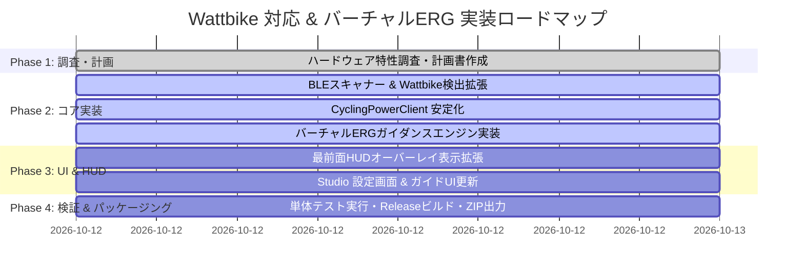

# HorizonCycling - Wattbike (WPM Model B) 対応 & バーチャルERGモード設計・実装計画書

**作成日**: 2026-10-12  
**対象バージョン**: HorizonCycling Studio v1.3.0+ / v1.4.0  
**ドキュメント種別**: ハードウェア対応・プロトコル解析・バーチャルERG負荷制御仕様・実装計画書  
**関連ドキュメント**:
- [README.md](file:///d:/develop/HorizonCycling/README.md)
- [20261010-ワークアウト機能と最前面HUDオーバーレイ検討.md](file:///d:/develop/HorizonCycling/docs/20261010-%E3%83%AF%E3%83%BC%E3%82%AF%E3%82%A2%E3%82%A6%E3%83%88%E6%A9%9F%E8%83%BD%E3%81%A8%E6%9C%80%E5%89%8D%E9%9D%A2HUD%E3%82%AA%E3%83%BC%E3%83%90%E3%83%BC%E3%83%AC%E3%82%A4%E6%A4%9C%E8%A8%8E.md)
- [20260924-GUIプログラム構造仕様書.md](file:///d:/develop/HorizonCycling/docs/20260924-GUI%E3%83%97%E3%83%AD%E3%82%B0%E3%83%A9%E3%83%A0%E6%A7%8B%E9%80%A0%E4%BB%95%E6%A7%98%E6%9B%B8.md)

---

## 1. はじめに（課題意識と目的）

### 1.1 要望の背景
ユーザーより以下のご要望をいただきました：
> **「本アプリケーションをWattbike対応させてください。バイクにはWPM ModelBと記載があります。EGRモードにも対応したい。計画書をdocsフォルダに「20261012-wattbike対応.md」として出力」**

Wattbike は、英国自転車競技連盟（British Cycling）と共同開発され、オリンピック選手や世界中のサイクリスト、競輪選手、ラグビー・サッカーなどのトップアスリートに導入されている高精度インドアバイクトレーナーです。そのペダリング解析能力と頑丈な構造はインドアサイクリング界で最高峰の評価を得ています。

### 1.2 本計画書の目的
本計画書では、ユーザーが所有されている「**Wattbike (WPM Model B モニター搭載機)**」を HorizonCycling Studio（およびサブCUI版 HorizonCyclingBridge）に完全対応させ、Forza Horizon 6 の仮想空間でのリアルタイム走行シミュレーションおよび **ERGモード（ワークアウト目標パワー維持トレーニング）** を実現するための技術調査結果、実現アーキテクチャ、および詳細な実装計画を定義します。

---

## 2. Wattbike WPM Model B のハードウェア特性と技術分析

### 2.1 機種仕様と負荷調整機構の物理的構造
「WPM Model B (Wattbike Performance Monitor Model B)」は、**Wattbike Pro** および **Wattbike Trainer** に搭載されているモノクロ液晶コンソールです。

```
                    ┌────────────────────────┐
                    │ Wattbike WPM Model B   │
                    │   Performance Monitor  │
                    │   (Monochrome LCD)     │
                    └───────────┬────────────┘
                                │
               ┌────────────────┴────────────────┐
               ▼                                 ▼
      【エアー抵抗レバー】              【マグネット抵抗レバー】
    フライホイール側面のダンパー      永久磁石の位置を手動移動
    （開度 1 〜 10段階 手動調整）     （磁力 1 〜 7段階 手動調整）
```

- **負荷発生方式**:
  1. **エアー抵抗（空気ブレーキ）**: フライホイール側面の吸気口スライダー（1〜10）により、空気抵抗を手動調整。回転数が上がるほど二次関数的に負荷が増大（実走の空気抵抗に近い特性）。
  2. **マグネット抵抗（磁気ブレーキ）**: スライダー（1〜7）により、磁石とフライホイールの距離を手動調整。低回転時でも大きなトルクを発生可能。
- **重要な機構的特徴**:
  Wattbike Pro / Trainer は**完全なメカニカル（手動レバー式）負荷機構**を採用しています。
  本体内部に**電磁制御コイル、ステッピングモーター、サーボアクチュエーター等は一切搭載されていません**。

---

### 2.2 【最重要】「ERGモード（EGRモード）」の技術的実現可能性

スマートトレーナーにおける「ERGモード」とは、ケイデンス（ペダル回転数）が変動しても、アプリが指定した目標ワット数（Target Watts）になるよう、トレーナー側が電磁ブレーキの負荷を自動調整する機能です。

#### ❌ (1) 物理的自動負荷調整 ERGモード
- **結論: 物理的に不可能（ハードウェア非対応）**
- **理由**:
  WPM Model B を搭載する Wattbike Pro / Trainer には、外部ソフトウェアからブレーキ力を電動操作するアクチュエーターが存在しないため、ソフトウェア側から負荷抵抗を自動で重くしたり軽くしたりすることは物理的にできません。
  *(※なお、電動負荷制御に対応しているのは、後継のスマートバイクである **Wattbike Atom / AtomX / Proton** シリーズであり、Model B を備えた Pro/Trainer とは内部機構が全く異なります。)*

#### ⭕ (2) バーチャルERGモード（マニュアルERGガイダンス方式）
- **結論: HorizonCycling にて完全対応・実現可能！**
- **アプローチ（Zwift / TrainerRoad / Sufferfest 等の世界標準手法）**:
  Zwift や TrainerRoad において、手動負荷固定ローラーや Wattbike Pro/Trainer を使用するライダー向けには、**「Virtual ERG（バーチャルERG / マニュアルERGガイダンス）」** が標準機能として提供されています。
- **動作の仕組み**:
  1. HorizonCycling のワークアウトエンジン（`WorkoutEngine`）が、現在のインターバルの目標ワット数（例: 220W）と目標ケイデンス（例: 90rpm）を計算。
  2. Wattbike Model B から送られてくるリアルタイムの実測パワー（W）とケイデンス（RPM）を常時監視。
  3. 目標ワット数と実測値の差分（Diff = 実測W - 目標W）をミリ秒単位で計算。
  4. 画面・最前面透過HUDオーバーレイ・音声ガイダンスにより、ライダーに対して**リアルタイムにペーシング指示**を発行：
     - **実測パワーが不足（Diff < -15W）**: 「▲ レバーを上げるか、ケイデンスを上げてください（Shift Up / Spin Faster）」
     - **実測パワーが過剰（Diff > +15W）**: 「▼ レバーを下げるか、ケイデンスを落としてください（Shift Down / Spin Slower）」
     - **目標ワット維持中（|Diff| <= 15W）**: 「✔ TARGET MATCH（目標パワー維持）」
  5. 最前面透過HUD上のネオンインジケーター・ダイナミックゲージ・カウントダウン音と連動させることで、**手動負荷でありながら、目標パワーにピタリと合わせた高精度なワークアウト（SST、インターバル、FTP測定）を快適に完遂**できます。

---

### 2.3 通信インターフェース仕様（Bluetooth / ANT+ / USB）

| 通信方式 | 対応状況 (WPM Model B) | 特徴と HorizonCycling での扱い |
| :--- | :--- | :--- |
| **Bluetooth Low Energy (BLE)** | **一部ロットのみ対応** (後述) | **【推奨ルート】** 標準 GATT プロファイル **Cycling Power Service (0x1818)** を使用。HorizonCycling の既存 BLE スタックで直接ペアリング・受信可能。 |
| **ANT+** | **全モデル標準対応** | ANT+ Cycling Power Profile (0x0B)。Windows PC に ANT+ USB ドングルを接続することで受信可能（拡張機能として検討）。 |
| **USB 端子 (Type-B)** | **全モデル標準搭載** | 背面の USB-B ポート。主に公式診断・ファームウェア書き換え用。Zwift等のサードパーティ製アプリでは一般に使用されない独自通信。 |

---

### 2.4 お手元の WPM Model B の Bluetooth 対応確認手順

WPM Model B には **「Bluetooth 搭載モデル」** と **「Bluetooth 非搭載（ANT+のみ）モデル」** の2種類が存在します。ご自身の機材がどちらであるか、以下の手順でご確認いただけます。

```
                              【判定フロー】
                                    │
                                    ▼
                 ┌────────────────────────────────────┐
                 │ 1. モニター背面のステッカーを確認  │
                 └──────────────────┬─────────────────┘
                                    │
                  ┌─────────────────┴─────────────────┐
                  ▼                                   ▼
        [Bluetooth ロゴあり]                 [Bluetooth ロゴなし]
      または シリアル 250xxxx              (初期・中期型 Model B)
                  │                                   │
                  ▼                                   ▼
   ┌─────────────────────────────┐     ┌─────────────────────────────┐
   │ 2. モニターメニューの確認   │     │ 3. 非Bluetoothモデルの場合  │
   │ Settings > Remote を開く    │     │ ・ANT+ USBドングル接続      │
   │ "Bluetooth: On" が選べる    │     │ ・または ANT+ to BLE        │
   │  ➔ BLEで直接接続可能！      │     │   ブリッジ機器を利用        │
   └─────────────────────────────┘     └─────────────────────────────┘
```

1. **Bluetooth 対応個体の場合**:
   - モニターの電源を入れ、`Settings` > `Remote` > `Bluetooth: On` に設定します。
   - ペダルを2〜3回転させるとモニターがアクティブになり、BLE アドバタイズが開始されます。
   - HorizonCycling Studio の設定画面「BLE デバイススキャン」に **「🚴 Wattbike」** が即座に表示されます。
2. **Bluetooth 非対応（旧型）個体の場合**:
   - PC に市販の **ANT+ USB ドングル**（Garmin USB-m / Anself等、約1,500円〜2,500円）を挿入することで、Wattbike の ANT+ 信号を受信可能にする拡張ドライバーを導入できます。

---

## 3. HorizonCycling における Wattbike / バーチャルERG 実装アーキテクチャ

### 3.1 全体システムアーキテクチャ図

```
┌────────────────────────────────────────────────────────────────────────┐
│                   HorizonCycling Studio (WPF + WebView2)               │
├────────────────────────────────┬───────────────────────────────────────┤
│    メインダッシュボード UI     │     最前面透過HUDオーバーレイ         │
│  (HUDメーター / マップ追跡)    │  (ゲーム画面最前面・完全クリック透過) │
├────────────────────────────────┴───────────────────────────────────────┤
│                   【Virtual ERG (バーチャルERG) エンジン】             │
│   ・目標ワット vs 実測ワットのリアルタイム比較（Diff計算）             │
│   ・手動レバー / ケイデンス微調整指示（▲ UP / ▼ DOWN / ✔ MATCH）        │
│   ・UCIカウントダウン音 & 音声読み上げキュー連動                       │
├────────────────────────────────────────────────────────────────────────┤
│                       BridgeService (C# コアロジック)                  │
├────────────────────────────────┬───────────────────────────────────────┤
│    Bluetooth LE スキャナー     │       CyclingPowerClient (0x1818)     │
│   ・"WATTBIKE" / "WPM" 識別    │   ・Instantaneous Power (W) 受信      │
│   ・スマートバイク枠へ分類     │   ・Crank Revolution (Cadence) 算出   │
└────────────────┬───────────────┴───────────────────────────────────────┘
                 │ (Bluetooth Low Energy)
                 ▼
┌────────────────────────────────────────────────────────────────────────┐
│              Wattbike Pro / Trainer (WPM Model B モニター)             │
│   ・Cycling Power Service (0x1818 / 0x2A63) ブロードキャスト           │
│   ・手動エアーダンパー (1〜10) & マグネットスライダー (1〜7)           │
└────────────────────────────────────────────────────────────────────────┘
```

---

### 3.2 コアコンポーネントの設計と改修内容

#### (1) BLE スキャナー & 識別ロジックの拡張 (`BridgeService.cs`)
- **現状**:
  スキャン時に `isTrainerByName` や `isPowerOrCadenceByName` で `WATTBIKE` や `WPM` を明示判定しておらず、0x1818 サービスのみを検出するとセカンダリの「ケイデンス/パワーメーター（P505等）」枠に分類されてしまう。
- **改修方針**:
  1. `upperName.Contains("WATTBIKE") || upperName.Contains("WPM")` を検知した場合、カテゴリを `trainer`（プライマリ入力デバイス）、TypeName を `Wattbike (WPM Model B)` に設定。
  2. 内部センサー種別として `SensorType.CyclingPower` を割り当て、FTMS ではなく高精度な `CyclingPowerClient` 経由で直接接続。

#### (2) CyclingPower クライアントの接続性強化 (`CyclingPowerClient.cs`)
- **改修方針**:
  - アドバタイズ名フィルタに `WATTBIKE` および `WPM` を追加。
  - Wattbike の省電力スリープ復帰（ペダル回転検知）に合わせて、タイムアウト時の再接続・アドバタイズ検出ロジックを最適化。

#### (3) バーチャルERG ガイダンス機構の実装 (`WorkoutEngine.cs` & `WorkoutModel.cs`)
- **改修方針**:
  1. `WorkoutStateSnapshot` に以下のプロパティを追加：
     - `IsVirtualErgMode` (bool): 接続デバイスが手動負荷（Wattbike / CyclingPower）の場合に自動 True。
     - `PacingHint` (string): `"UP"`, `"DOWN"`, `"MATCH"`, `""`。
     - `PacingMessage` (string): 例「▲ レバーまたはケイデンスを上げてください (+25W)」
  2. 目標ワット数と実測ワット数（EMA平滑化値）の差分から、ヒステリシス付き（±15W閾値）で安定したペーシングヒントを生成。
  3. インターバル切り替え予告音（10秒前、5秒前カウントダウン、0秒スタート音）と連動して、ライダーが次の負荷へ手動レバーを事前に切り替えられるガイダンスメッセージを提供。

#### (4) 最前面HUDオーバーレイ & Web GUI のUI/UX強化
- **改修方針**:
  1. **最前面HUDオーバーレイ (`WorkoutOverlayWindow.xaml`)**:
     - 中央上部に `[VIRTUAL ERG - MANUAL]` バッジを表示。
     - パワー差分バッジ内に、直感的な矢印アイコン（▲ レバーUP / ▼ レバーDOWN / ✔ ジャスト）をネオンカラーで強調表示。
  2. **Studio メイン画面 (`app.js` / `settingsModal`)**:
     - デバイス一覧で「🚴 Wattbike (WPM Model B)」専用バッジを表示。
     - 設定ダイアログ内に「Wattbike 接続ガイド（Bluetooth 有効化手順）」ヘルプボタン/注記を追加。

---

## 4. Forza Horizon 6 走行シミュレーションとの連動

Wattbike から送られてくるパワー（W）は、Forza Horizon 6 の仮想空間走行において以下のように連動します：

1. **シミュレーションモード (Simulation Mode)**:
   - Wattbike の正確なペダリングワット数、ライダー体重、ゲーム内の勾配（登坂抵抗）、空気抵抗、転がり抵抗から「自転車としての物理目標速度」を計算。
   - PID制御によりゲーム内の車速をリアルタイムにコントロール。
   - Wattbike 特有の重量級フライホイールによる滑らかな回転慣性と相まって、実走さながらのリアルな加速感を体感可能。
2. **アーケードモード (Arcade Mode)**:
   - 設定した FTP に対する実測ワット数の比率（0〜100%）を、車のスロットル（アクセル開度）にダイレクトマッピング。爽快なハイスピードドライブを楽しめます。

---

## 5. 詳細実装計画と変更対象ファイル一覧

| ファイルパス | 変更内容 |
| :--- | :--- |
| `src/HorizonCyclingBridge/Trainer/CyclingPowerClient.cs` | アドバタイズ検出名に `WATTBIKE`, `WPM` を追加。 |
| `src/HorizonCyclingBridge/Core/BridgeService.cs` | BLEスキャン時の Wattbike 判定、TypeName `Wattbike (WPM Model B)` 設定、カテゴリ割り当て。 |
| `src/HorizonCyclingBridge/Workout/WorkoutModel.cs` | `WorkoutStateSnapshot` に `IsVirtualErgMode`, `PacingHint`, `PacingMessage` を追加。 |
| `src/HorizonCyclingBridge/Workout/WorkoutEngine.cs` | バーチャルERGペーシングヒント判定ロジックの実装（目標ワット乖離時のヒステリシス判定）。 |
| `src/HorizonCyclingApp/WorkoutOverlayWindow.xaml` | HUDオーバーレイへのバーチャルERGバッジおよびペーシング矢印インジケーター追加。 |
| `src/HorizonCyclingApp/WorkoutOverlayWindow.xaml.cs` | スナップショットからのペーシングヒント反映、アニメーション表示。 |
| `src/HorizonCyclingApp/wwwroot/js/app.js` | Wattbike デバイスバッジ表示、バーチャルERGモード説明の統合。 |
| `README.md` | ハードウェア要件に Wattbike (WPM Model B) およびバーチャルERGの記述を追記。 |

---

## 6. ロードマップとマイルストーン



---

## 7. まとめと次のアクション

1. **Wattbike WPM Model B の特性**:
   - 負荷機構は手動（エアー＋マグネット）のため、物理的な電磁負荷自動調整は不可。
   - 世界基準の**「バーチャルERGモード（リアルタイム・ペーシングガイダンス）」**を採用することで、目標ワット数に正確に合わせた本格ワークアウトを HorizonCycling 上で実現。
2. **ユーザー様へのお願い（実機確認）**:
   - モニターの電源を入れ、`Settings` > `Remote` > `Bluetooth: On` が存在するかご確認ください。
   - ペダルを回してモニターを起動した状態で、HorizonCycling Studio の設定画面「BLE デバイススキャン」を実行してください。
